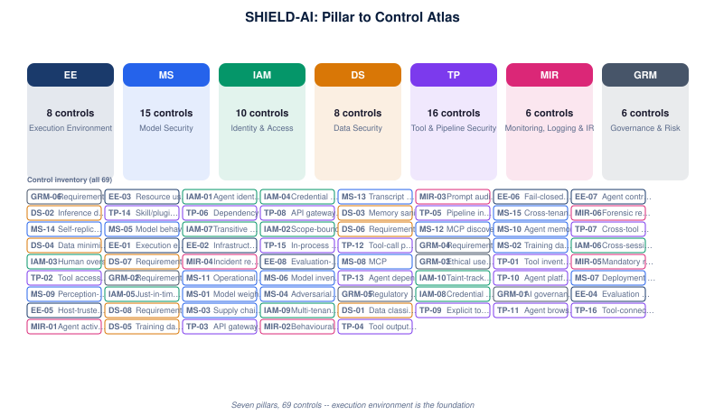

# 01 · Pillar → Control Atlas

A simplified inventory of the **seven pillars** and their **69 controls**. Use this to see
the full control surface at a glance: every control belongs to exactly one pillar, and the
pillars are ordered by the logical dependencies they introduce (execution environment is
the foundation).

## Controls by pillar

### EE — Execution Environment

| ID | Control |
|---|---|
| EE-08 | Evaluation-harness isolation and integrity |
| EE-03 | Resource usage limiting |
| EE-07 | Agent control-plane configuration integrity |
| EE-02 | Infrastructure API access control |
| EE-01 | Execution environment boundary enforcement |
| EE-05 | Host-trusted configuration file injection prevention |
| EE-04 | Evaluation sandbox integrity |
| EE-06 | Fail-closed sandbox operation |

### MS — Model Security

| ID | Control |
|---|---|
| MS-14 | Self-replication barrier |
| MS-15 | Cross-tenant agent memory and state isolation |
| MS-06 | Model inventory and lineage tracking |
| MS-13 | Transcript and conversation authenticity |
| MS-07 | Deployment context obfuscation |
| MS-04 | Adversarial robustness |
| MS-05 | Model behaviour validation |
| MS-09 | Perception-fidelity enforcement for human-in-the-loop approvals |
| MS-11 | Operational data-stream integrity |
| MS-08 | MCP |
| MS-01 | Model weight protection |
| MS-02 | Training data integrity |
| MS-10 | Agent memory-store integrity |
| MS-03 | Supply chain security |
| MS-12 | MCP discovery-metadata and shared-cache integrity |

### IAM — Identity & Access

| ID | Control |
|---|---|
| IAM-07 | Transitive delegation chain enforcement |
| IAM-10 | Taint-tracked least-privilege subagent scoping |
| IAM-06 | Cross-session boundary enforcement |
| IAM-08 | Credential scope narrowing |
| IAM-03 | Human oversight controls |
| IAM-09 | Multi-tenant agent platform isolation |
| IAM-05 | Just-in-time access |
| IAM-04 | Credential isolation |
| IAM-01 | Agent identity management |
| IAM-02 | Scope-bound delegation |

### DS — Data Security

| ID | Control |
|---|---|
| DS-02 | Inference data protection |
| DS-04 | Data minimisation |
| DS-05 | Training data governance |
| DS-03 | Memory sanitisation |
| DS-08 | Requirement:** Destination and emergent-channel egress inventory |
| DS-07 | Requirement:** Agent-originated artifact publication control |
| DS-06 | Requirement:** Output validation |
| DS-01 | Data classification and labelling |

### TP — Tool & Pipeline Security

| ID | Control |
|---|---|
| TP-04 | Tool output validation |
| TP-10 | Agent platform inbound control-plane protection |
| TP-09 | Explicit tool registration — no implicit tool exposure |
| TP-16 | Tool-connection and launch-path integrity |
| TP-01 | Tool inventory and registry |
| TP-07 | Cross-tool dependency analysis |
| TP-03 | API gateway security |
| TP-06 | Dependency scanning |
| TP-13 | Agent dependency-install provenance verification |
| TP-15 | In-process code-execution sandbox sufficiency |
| TP-12 | Tool-call provenance and dispatch verification |
| TP-02 | Tool access control |
| TP-11 | Agent browser and content-rendering isolation |
| TP-08 | API gateway infrastructure-isolation mode |
| TP-05 | Pipeline integrity |
| TP-14 | Skill/plugin payload integrity and instruction-channel isolation |

### MIR — Monitoring, Logging & IR

| ID | Control |
|---|---|
| MIR-04 | Incident response playbooks AI-specific IR procedures distinct from general IR: prompt injection containment, model rollback, tool access revocation, session invalidation; |
| MIR-05 | Mandatory reporting integration |
| MIR-06 | Forensic readiness |
| MIR-03 | Prompt audit log |
| MIR-02 | Behavioural anomaly detection baseline per-agent behaviour established over training period; alerts on deviation  --  unusual tool, unusual data access pattern, unusual frequency; |
| MIR-01 | Agent activity logging |

### GRM — Governance & Risk

| ID | Control |
|---|---|
| GRM-04 | Requirement:** Third-party AI risk management |
| GRM-02 | Requirement:** AI risk register |
| GRM-03 | Ethical use policy |
| GRM-06 | Requirement:** Board and executive reporting |
| GRM-01 | AI governance body |
| GRM-05 | Regulatory mapping and compliance reporting |

## Signal for architects

- **EE → MS → IAM → DS → TP → MIR → GRM** is the dependency order: an escaped execution
  environment invalidates every control layered above it.
- **MS (15) and TP (16)** carry the most controls — model integrity and tool/pipeline
  security are where the framework concentrates its coverage.
