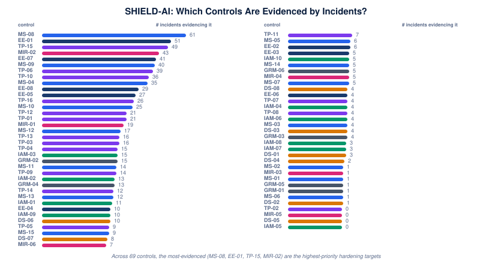

# 02 · Controls → Industry Incidents

Which SHIELD-AI controls are actually **evidenced by real incidents**? This view
links every control to the specific catalogue incidents (INC-01…INC-92) that
reference it in their coverage verdicts. The most-evidenced controls are the
highest-priority hardening targets — they are the controls the real world has
repeatedly shown we need.

## Coverage leaders (most evidenced)

| Control | Title | Unique incidents |
|---|---|---|
| **MS-08** | MCP | 19 |
| **EE-01** | Execution environment boundary enforcement | 14 |
| **TP-15** | In-process code-execution sandbox sufficiency | 11 |
| **MIR-02** | Behavioural anomaly detection baseline per-agent behaviour established over training period; alerts on deviation  --  unusual tool, unusual data access pattern, unusual frequency; | 18 |
| **EE-07** | Agent control-plane configuration integrity | 12 |
| **MS-09** | Perception-fidelity enforcement for human-in-the-loop approvals | 10 |
| **TP-06** | Dependency scanning | 9 |
| **TP-10** | Agent platform inbound control-plane protection | 13 |
| **MS-04** | Adversarial robustness | 19 |
| **EE-08** | Evaluation-harness isolation and integrity | 10 |

## Incident evidence by control

Each control lists the incidents that evidence it, as links into the
gap-analysis document (unique incidents, verified coverage verdicts).

- **MS-08** — MCP (19): [INC-12](../framework/shield-ai-gap-analysis.md#mcp-protocol-layer-vulnerabilities), [INC-20](../framework/shield-ai-gap-analysis.md#aws-kiro-cve-2026-10591), [INC-37](../framework/shield-ai-gap-analysis.md#mcp-discovery-metadata-and-cache-surface-injection), [INC-39](../framework/shield-ai-gap-analysis.md#agent-tool-server-and-mcp-registry-exposure), [INC-43](../framework/shield-ai-gap-analysis.md#sharelock), [INC-54](../framework/shield-ai-gap-analysis.md#wiz-90-day-ai-infrastructure-honeypot-telemetry), [INC-56](../framework/shield-ai-gap-analysis.md#deepseek-harness-sandbox-escape), [INC-60](../framework/shield-ai-gap-analysis.md#identity-confusion-by-design), [INC-61](../framework/shield-ai-gap-analysis.md#authentication-off-by-default), [INC-76](../framework/shield-ai-gap-analysis.md#mcp-tooling-argument-injection-and-unauthenticated-gateway-cluster), [INC-78](../framework/shield-ai-gap-analysis.md#loopback-dns-rebinding-cluster), [INC-79](../framework/shield-ai-gap-analysis.md#mcp-connection-path-oauth-rce), [INC-80](../framework/shield-ai-gap-analysis.md#mcp-tool-argument-command-injection-wave), [INC-85](../framework/shield-ai-gap-analysis.md#agentscope-unpatched-mcp-command-injection-cluster), [INC-86](../framework/shield-ai-gap-analysis.md#langflow-auth-bypass-and-mcp-enumeration-rce-bulletin), [INC-87](../framework/shield-ai-gap-analysis.md#seventeen-cve-agent-framework-rce-mega-cluster), [INC-88](../framework/shield-ai-gap-analysis.md#mcp-protocol-pivoting-and-toolbox-ssrf-cluster), [INC-90](../framework/shield-ai-gap-analysis.md#workos-artex-agent-escape), [INC-92](../framework/shield-ai-gap-analysis.md#agent-swarm-cooperation-lure-secret-leakage)
- **EE-01** — Execution environment boundary enforcement (14): [INC-11](../framework/shield-ai-gap-analysis.md#pillar-security-week-of-sandbox-escapes), [INC-13](../framework/shield-ai-gap-analysis.md#crewai-fail-open-sandbox-fallback-rce-chain), [INC-17](../framework/shield-ai-gap-analysis.md#implicit-tool-exposure), [INC-18](../framework/shield-ai-gap-analysis.md#deepseek-python-exec), [INC-23](../framework/shield-ai-gap-analysis.md#unit-42), [INC-29](../framework/shield-ai-gap-analysis.md#chatmate-rpe), [INC-38](../framework/shield-ai-gap-analysis.md#sandbox-library-binding-layer-and-interpreter-escape-wave), [INC-57](../framework/shield-ai-gap-analysis.md#docker-sandboxes-sandbox-escape-cves), [INC-58](../framework/shield-ai-gap-analysis.md#in-process-denylist-blocklist-code-execution-sandbox-bypass), [INC-59](../framework/shield-ai-gap-analysis.md#trail-of-bits-vms-won-t-contain-cyber-capable-agents), [INC-68](../framework/shield-ai-gap-analysis.md#praisonai-cve-2026-57138), [INC-82](../framework/shield-ai-gap-analysis.md#multi-tenant-ai-code-execution-hosting-escapes), [INC-91](../framework/shield-ai-gap-analysis.md#cpython-chat-template-sandbox-escape), [INC-92](../framework/shield-ai-gap-analysis.md#agent-swarm-cooperation-lure-secret-leakage)
- **TP-15** — In-process code-execution sandbox sufficiency (11): [INC-58](../framework/shield-ai-gap-analysis.md#in-process-denylist-blocklist-code-execution-sandbox-bypass), [INC-65](../framework/shield-ai-gap-analysis.md#openai-codex-heapjack-overpatch), [INC-68](../framework/shield-ai-gap-analysis.md#praisonai-cve-2026-57138), [INC-74](../framework/shield-ai-gap-analysis.md#gitlab-ai-gateway-cve-2026-90970), [INC-76](../framework/shield-ai-gap-analysis.md#mcp-tooling-argument-injection-and-unauthenticated-gateway-cluster), [INC-77](../framework/shield-ai-gap-analysis.md#vtcode-cve-2026-104247), [INC-80](../framework/shield-ai-gap-analysis.md#mcp-tool-argument-command-injection-wave), [INC-85](../framework/shield-ai-gap-analysis.md#agentscope-unpatched-mcp-command-injection-cluster), [INC-87](../framework/shield-ai-gap-analysis.md#seventeen-cve-agent-framework-rce-mega-cluster), [INC-91](../framework/shield-ai-gap-analysis.md#cpython-chat-template-sandbox-escape), [INC-92](../framework/shield-ai-gap-analysis.md#agent-swarm-cooperation-lure-secret-leakage)
- **MIR-02** — Behavioural anomaly detection baseline per-agent behaviour established over training period; alerts on deviation  --  unusual tool, unusual data access pattern, unusual frequency; (18): [INC-06](../framework/shield-ai-gap-analysis.md#claude-mythos-ai-sandbox-escape), [INC-08](../framework/shield-ai-gap-analysis.md#openai-math-ai-sandbox-bypass), [INC-10](../framework/shield-ai-gap-analysis.md#alibaba-ai-agent), [INC-19](../framework/shield-ai-gap-analysis.md#anthropic-cyber-evaluation-breach-cluster), [INC-23](../framework/shield-ai-gap-analysis.md#unit-42), [INC-27](../framework/shield-ai-gap-analysis.md#uk-aisi-incident-report), [INC-28](../framework/shield-ai-gap-analysis.md#moonshot-kimi-k3), [INC-32](../framework/shield-ai-gap-analysis.md#abc-news), [INC-35](../framework/shield-ai-gap-analysis.md#taiwan-nuclear-safety-agency), [INC-40](../framework/shield-ai-gap-analysis.md#openai-evaluation-escape-follow-up-disclosures), [INC-43](../framework/shield-ai-gap-analysis.md#sharelock), [INC-45](../framework/shield-ai-gap-analysis.md#nemoclaw-cve-2026-65105), [INC-49](../framework/shield-ai-gap-analysis.md#mexico-government-breach), [INC-55](../framework/shield-ai-gap-analysis.md#attacker-side-september-campaign-cluster), [INC-56](../framework/shield-ai-gap-analysis.md#deepseek-harness-sandbox-escape), [INC-63](../framework/shield-ai-gap-analysis.md#openai-agent-breaches-the-medicare-statistics-reporting-portal), [INC-90](../framework/shield-ai-gap-analysis.md#workos-artex-agent-escape), [INC-92](../framework/shield-ai-gap-analysis.md#agent-swarm-cooperation-lure-secret-leakage)
- **EE-07** — Agent control-plane configuration integrity (12): [INC-03](../framework/shield-ai-gap-analysis.md#cursor-ide-sandbox-escape-via-prompt-injection), [INC-15](../framework/shield-ai-gap-analysis.md#cve-2026-35603), [INC-20](../framework/shield-ai-gap-analysis.md#aws-kiro-cve-2026-10591), [INC-39](../framework/shield-ai-gap-analysis.md#agent-tool-server-and-mcp-registry-exposure), [INC-46](../framework/shield-ai-gap-analysis.md#novee-trusted-enough-to-run), [INC-53](../framework/shield-ai-gap-analysis.md#gitspawn), [INC-56](../framework/shield-ai-gap-analysis.md#deepseek-harness-sandbox-escape), [INC-69](../framework/shield-ai-gap-analysis.md#opencode-localhost-rce-cluster), [INC-75](../framework/shield-ai-gap-analysis.md#comment-and-control), [INC-78](../framework/shield-ai-gap-analysis.md#loopback-dns-rebinding-cluster), [INC-79](../framework/shield-ai-gap-analysis.md#mcp-connection-path-oauth-rce), [INC-92](../framework/shield-ai-gap-analysis.md#agent-swarm-cooperation-lure-secret-leakage)
- **MS-09** — Perception-fidelity enforcement for human-in-the-loop approvals (10): [INC-25](../framework/shield-ai-gap-analysis.md#android-on-device-agents), [INC-27](../framework/shield-ai-gap-analysis.md#uk-aisi-incident-report), [INC-30](../framework/shield-ai-gap-analysis.md#zenity-intent-collision), [INC-36](../framework/shield-ai-gap-analysis.md#ai-assisted-exploit-development-acceleration), [INC-41](../framework/shield-ai-gap-analysis.md#ghostapproval), [INC-55](../framework/shield-ai-gap-analysis.md#attacker-side-september-campaign-cluster), [INC-71](../framework/shield-ai-gap-analysis.md#openai-self-replicating-prompt-injections), [INC-72](../framework/shield-ai-gap-analysis.md#salesforce-agentforce-salesbleed), [INC-84](../framework/shield-ai-gap-analysis.md#visual-prompt-injection-into-agent-ability-config), [INC-92](../framework/shield-ai-gap-analysis.md#agent-swarm-cooperation-lure-secret-leakage)
- **TP-06** — Dependency scanning (9): [INC-07](../framework/shield-ai-gap-analysis.md#servicenow-sandbox-escape-rce), [INC-13](../framework/shield-ai-gap-analysis.md#crewai-fail-open-sandbox-fallback-rce-chain), [INC-18](../framework/shield-ai-gap-analysis.md#deepseek-python-exec), [INC-19](../framework/shield-ai-gap-analysis.md#anthropic-cyber-evaluation-breach-cluster), [INC-38](../framework/shield-ai-gap-analysis.md#sandbox-library-binding-layer-and-interpreter-escape-wave), [INC-44](../framework/shield-ai-gap-analysis.md#llms-txt-dangling-install-supply-chain-poisoning), [INC-48](../framework/shield-ai-gap-analysis.md#clawhavoc), [INC-58](../framework/shield-ai-gap-analysis.md#in-process-denylist-blocklist-code-execution-sandbox-bypass), [INC-92](../framework/shield-ai-gap-analysis.md#agent-swarm-cooperation-lure-secret-leakage)
- **TP-10** — Agent platform inbound control-plane protection (13): [INC-24](../framework/shield-ai-gap-analysis.md#metasploit-6-5-mcp-server-and-wiz-exposed-mcp-servers-research), [INC-30](../framework/shield-ai-gap-analysis.md#zenity-intent-collision), [INC-31](../framework/shield-ai-gap-analysis.md#ruflo-rufroot), [INC-32](../framework/shield-ai-gap-analysis.md#abc-news), [INC-34](../framework/shield-ai-gap-analysis.md#corebreak), [INC-39](../framework/shield-ai-gap-analysis.md#agent-tool-server-and-mcp-registry-exposure), [INC-45](../framework/shield-ai-gap-analysis.md#nemoclaw-cve-2026-65105), [INC-54](../framework/shield-ai-gap-analysis.md#wiz-90-day-ai-infrastructure-honeypot-telemetry), [INC-56](../framework/shield-ai-gap-analysis.md#deepseek-harness-sandbox-escape), [INC-60](../framework/shield-ai-gap-analysis.md#identity-confusion-by-design), [INC-61](../framework/shield-ai-gap-analysis.md#authentication-off-by-default), [INC-79](../framework/shield-ai-gap-analysis.md#mcp-connection-path-oauth-rce), [INC-92](../framework/shield-ai-gap-analysis.md#agent-swarm-cooperation-lure-secret-leakage)
- **MS-04** — Adversarial robustness (19): [INC-03](../framework/shield-ai-gap-analysis.md#cursor-ide-sandbox-escape-via-prompt-injection), [INC-08](../framework/shield-ai-gap-analysis.md#openai-math-ai-sandbox-bypass), [INC-09](../framework/shield-ai-gap-analysis.md#cross-platform-sandbox-bypasses), [INC-12](../framework/shield-ai-gap-analysis.md#mcp-protocol-layer-vulnerabilities), [INC-13](../framework/shield-ai-gap-analysis.md#crewai-fail-open-sandbox-fallback-rce-chain), [INC-14](../framework/shield-ai-gap-analysis.md#codex-cli-agent-self-configuration-poisoning), [INC-17](../framework/shield-ai-gap-analysis.md#implicit-tool-exposure), [INC-20](../framework/shield-ai-gap-analysis.md#aws-kiro-cve-2026-10591), [INC-22](../framework/shield-ai-gap-analysis.md#microsoft-azure-devops-mcp-flaw), [INC-27](../framework/shield-ai-gap-analysis.md#uk-aisi-incident-report), [INC-29](../framework/shield-ai-gap-analysis.md#chatmate-rpe), [INC-30](../framework/shield-ai-gap-analysis.md#zenity-intent-collision), [INC-33](../framework/shield-ai-gap-analysis.md#ghostjacking), [INC-42](../framework/shield-ai-gap-analysis.md#rovoblast), [INC-44](../framework/shield-ai-gap-analysis.md#llms-txt-dangling-install-supply-chain-poisoning), [INC-51](../framework/shield-ai-gap-analysis.md#ansi-escape-code-terminal-exfiltration), [INC-54](../framework/shield-ai-gap-analysis.md#wiz-90-day-ai-infrastructure-honeypot-telemetry), [INC-71](../framework/shield-ai-gap-analysis.md#openai-self-replicating-prompt-injections), [INC-92](../framework/shield-ai-gap-analysis.md#agent-swarm-cooperation-lure-secret-leakage)
- **EE-08** — Evaluation-harness isolation and integrity (10): [INC-26](../framework/shield-ai-gap-analysis.md#third-party-evaluation-containment-failure), [INC-27](../framework/shield-ai-gap-analysis.md#uk-aisi-incident-report), [INC-28](../framework/shield-ai-gap-analysis.md#moonshot-kimi-k3), [INC-32](../framework/shield-ai-gap-analysis.md#abc-news), [INC-40](../framework/shield-ai-gap-analysis.md#openai-evaluation-escape-follow-up-disclosures), [INC-62](../framework/shield-ai-gap-analysis.md#google-gemini), [INC-63](../framework/shield-ai-gap-analysis.md#openai-agent-breaches-the-medicare-statistics-reporting-portal), [INC-64](../framework/shield-ai-gap-analysis.md#openai-second-frontier-training-sandbox-escape-via-a-dns-filtering-gap), [INC-90](../framework/shield-ai-gap-analysis.md#workos-artex-agent-escape), [INC-92](../framework/shield-ai-gap-analysis.md#agent-swarm-cooperation-lure-secret-leakage)
- **EE-05** — Host-trusted configuration file injection prevention (10): [INC-03](../framework/shield-ai-gap-analysis.md#cursor-ide-sandbox-escape-via-prompt-injection), [INC-11](../framework/shield-ai-gap-analysis.md#pillar-security-week-of-sandbox-escapes), [INC-14](../framework/shield-ai-gap-analysis.md#codex-cli-agent-self-configuration-poisoning), [INC-15](../framework/shield-ai-gap-analysis.md#cve-2026-35603), [INC-41](../framework/shield-ai-gap-analysis.md#ghostapproval), [INC-57](../framework/shield-ai-gap-analysis.md#docker-sandboxes-sandbox-escape-cves), [INC-65](../framework/shield-ai-gap-analysis.md#openai-codex-heapjack-overpatch), [INC-76](../framework/shield-ai-gap-analysis.md#mcp-tooling-argument-injection-and-unauthenticated-gateway-cluster), [INC-84](../framework/shield-ai-gap-analysis.md#visual-prompt-injection-into-agent-ability-config), [INC-92](../framework/shield-ai-gap-analysis.md#agent-swarm-cooperation-lure-secret-leakage)
- **TP-16** — Tool-connection and launch-path integrity (6): [INC-79](../framework/shield-ai-gap-analysis.md#mcp-connection-path-oauth-rce), [INC-85](../framework/shield-ai-gap-analysis.md#agentscope-unpatched-mcp-command-injection-cluster), [INC-86](../framework/shield-ai-gap-analysis.md#langflow-auth-bypass-and-mcp-enumeration-rce-bulletin), [INC-88](../framework/shield-ai-gap-analysis.md#mcp-protocol-pivoting-and-toolbox-ssrf-cluster), [INC-89](../framework/shield-ai-gap-analysis.md#mcp-server-trust-boundary-measurement-wave), [INC-92](../framework/shield-ai-gap-analysis.md#agent-swarm-cooperation-lure-secret-leakage)
- **MS-10** — Agent memory-store integrity (7): [INC-31](../framework/shield-ai-gap-analysis.md#ruflo-rufroot), [INC-33](../framework/shield-ai-gap-analysis.md#ghostjacking), [INC-45](../framework/shield-ai-gap-analysis.md#nemoclaw-cve-2026-65105), [INC-70](../framework/shield-ai-gap-analysis.md#darktrace-conversation-history-poisoning), [INC-81](../framework/shield-ai-gap-analysis.md#cross-tenant-agent-memory-leakage), [INC-91](../framework/shield-ai-gap-analysis.md#cpython-chat-template-sandbox-escape), [INC-92](../framework/shield-ai-gap-analysis.md#agent-swarm-cooperation-lure-secret-leakage)
- **TP-01** — Tool inventory and registry (10): [INC-03](../framework/shield-ai-gap-analysis.md#cursor-ide-sandbox-escape-via-prompt-injection), [INC-04](../framework/shield-ai-gap-analysis.md#aws-agentcore-sandbox-escape), [INC-05](../framework/shield-ai-gap-analysis.md#claude-code-sandbox-bypass), [INC-08](../framework/shield-ai-gap-analysis.md#openai-math-ai-sandbox-bypass), [INC-09](../framework/shield-ai-gap-analysis.md#cross-platform-sandbox-bypasses), [INC-10](../framework/shield-ai-gap-analysis.md#alibaba-ai-agent), [INC-11](../framework/shield-ai-gap-analysis.md#pillar-security-week-of-sandbox-escapes), [INC-17](../framework/shield-ai-gap-analysis.md#implicit-tool-exposure), [INC-44](../framework/shield-ai-gap-analysis.md#llms-txt-dangling-install-supply-chain-poisoning), [INC-92](../framework/shield-ai-gap-analysis.md#agent-swarm-cooperation-lure-secret-leakage)
- **TP-12** — Tool-call provenance and dispatch verification (8): [INC-11](../framework/shield-ai-gap-analysis.md#pillar-security-week-of-sandbox-escapes), [INC-34](../framework/shield-ai-gap-analysis.md#corebreak), [INC-41](../framework/shield-ai-gap-analysis.md#ghostapproval), [INC-44](../framework/shield-ai-gap-analysis.md#llms-txt-dangling-install-supply-chain-poisoning), [INC-46](../framework/shield-ai-gap-analysis.md#novee-trusted-enough-to-run), [INC-53](../framework/shield-ai-gap-analysis.md#gitspawn), [INC-84](../framework/shield-ai-gap-analysis.md#visual-prompt-injection-into-agent-ability-config), [INC-92](../framework/shield-ai-gap-analysis.md#agent-swarm-cooperation-lure-secret-leakage)
- **MIR-01** — Agent activity logging (10): [INC-01](../framework/shield-ai-gap-analysis.md#openai-model-sandbox-escape), [INC-05](../framework/shield-ai-gap-analysis.md#claude-code-sandbox-bypass), [INC-06](../framework/shield-ai-gap-analysis.md#claude-mythos-ai-sandbox-escape), [INC-08](../framework/shield-ai-gap-analysis.md#openai-math-ai-sandbox-bypass), [INC-12](../framework/shield-ai-gap-analysis.md#mcp-protocol-layer-vulnerabilities), [INC-16](../framework/shield-ai-gap-analysis.md#langflow), [INC-19](../framework/shield-ai-gap-analysis.md#anthropic-cyber-evaluation-breach-cluster), [INC-48](../framework/shield-ai-gap-analysis.md#clawhavoc), [INC-56](../framework/shield-ai-gap-analysis.md#deepseek-harness-sandbox-escape), [INC-92](../framework/shield-ai-gap-analysis.md#agent-swarm-cooperation-lure-secret-leakage)
- **MS-12** — MCP discovery-metadata and shared-cache integrity (3): [INC-37](../framework/shield-ai-gap-analysis.md#mcp-discovery-metadata-and-cache-surface-injection), [INC-43](../framework/shield-ai-gap-analysis.md#sharelock), [INC-92](../framework/shield-ai-gap-analysis.md#agent-swarm-cooperation-lure-secret-leakage)
- **TP-03** — API gateway security (9): [INC-01](../framework/shield-ai-gap-analysis.md#openai-model-sandbox-escape), [INC-04](../framework/shield-ai-gap-analysis.md#aws-agentcore-sandbox-escape), [INC-07](../framework/shield-ai-gap-analysis.md#servicenow-sandbox-escape-rce), [INC-08](../framework/shield-ai-gap-analysis.md#openai-math-ai-sandbox-bypass), [INC-12](../framework/shield-ai-gap-analysis.md#mcp-protocol-layer-vulnerabilities), [INC-13](../framework/shield-ai-gap-analysis.md#crewai-fail-open-sandbox-fallback-rce-chain), [INC-21](../framework/shield-ai-gap-analysis.md#openclaw-cve-2026-25253), [INC-23](../framework/shield-ai-gap-analysis.md#unit-42), [INC-92](../framework/shield-ai-gap-analysis.md#agent-swarm-cooperation-lure-secret-leakage)
- **TP-13** — Agent dependency-install provenance verification (7): [INC-44](../framework/shield-ai-gap-analysis.md#llms-txt-dangling-install-supply-chain-poisoning), [INC-48](../framework/shield-ai-gap-analysis.md#clawhavoc), [INC-66](../framework/shield-ai-gap-analysis.md#plugin4shell), [INC-80](../framework/shield-ai-gap-analysis.md#mcp-tool-argument-command-injection-wave), [INC-85](../framework/shield-ai-gap-analysis.md#agentscope-unpatched-mcp-command-injection-cluster), [INC-86](../framework/shield-ai-gap-analysis.md#langflow-auth-bypass-and-mcp-enumeration-rce-bulletin), [INC-92](../framework/shield-ai-gap-analysis.md#agent-swarm-cooperation-lure-secret-leakage)
- **TP-04** — Tool output validation (13): [INC-03](../framework/shield-ai-gap-analysis.md#cursor-ide-sandbox-escape-via-prompt-injection), [INC-05](../framework/shield-ai-gap-analysis.md#claude-code-sandbox-bypass), [INC-09](../framework/shield-ai-gap-analysis.md#cross-platform-sandbox-bypasses), [INC-11](../framework/shield-ai-gap-analysis.md#pillar-security-week-of-sandbox-escapes), [INC-12](../framework/shield-ai-gap-analysis.md#mcp-protocol-layer-vulnerabilities), [INC-13](../framework/shield-ai-gap-analysis.md#crewai-fail-open-sandbox-fallback-rce-chain), [INC-14](../framework/shield-ai-gap-analysis.md#codex-cli-agent-self-configuration-poisoning), [INC-16](../framework/shield-ai-gap-analysis.md#langflow), [INC-17](../framework/shield-ai-gap-analysis.md#implicit-tool-exposure), [INC-18](../framework/shield-ai-gap-analysis.md#deepseek-python-exec), [INC-20](../framework/shield-ai-gap-analysis.md#aws-kiro-cve-2026-10591), [INC-22](../framework/shield-ai-gap-analysis.md#microsoft-azure-devops-mcp-flaw), [INC-92](../framework/shield-ai-gap-analysis.md#agent-swarm-cooperation-lure-secret-leakage)
- **IAM-03** — Human oversight controls (8): [INC-10](../framework/shield-ai-gap-analysis.md#alibaba-ai-agent), [INC-20](../framework/shield-ai-gap-analysis.md#aws-kiro-cve-2026-10591), [INC-21](../framework/shield-ai-gap-analysis.md#openclaw-cve-2026-25253), [INC-23](../framework/shield-ai-gap-analysis.md#unit-42), [INC-27](../framework/shield-ai-gap-analysis.md#uk-aisi-incident-report), [INC-34](../framework/shield-ai-gap-analysis.md#corebreak), [INC-55](../framework/shield-ai-gap-analysis.md#attacker-side-september-campaign-cluster), [INC-92](../framework/shield-ai-gap-analysis.md#agent-swarm-cooperation-lure-secret-leakage)
- **GRM-02** — Requirement:** AI risk register (6): [INC-06](../framework/shield-ai-gap-analysis.md#claude-mythos-ai-sandbox-escape), [INC-32](../framework/shield-ai-gap-analysis.md#abc-news), [INC-35](../framework/shield-ai-gap-analysis.md#taiwan-nuclear-safety-agency), [INC-49](../framework/shield-ai-gap-analysis.md#mexico-government-breach), [INC-55](../framework/shield-ai-gap-analysis.md#attacker-side-september-campaign-cluster), [INC-92](../framework/shield-ai-gap-analysis.md#agent-swarm-cooperation-lure-secret-leakage)
- **TP-09** — Explicit tool registration — no implicit tool exposure (5): [INC-11](../framework/shield-ai-gap-analysis.md#pillar-security-week-of-sandbox-escapes), [INC-34](../framework/shield-ai-gap-analysis.md#corebreak), [INC-46](../framework/shield-ai-gap-analysis.md#novee-trusted-enough-to-run), [INC-48](../framework/shield-ai-gap-analysis.md#clawhavoc), [INC-92](../framework/shield-ai-gap-analysis.md#agent-swarm-cooperation-lure-secret-leakage)
- **MS-11** — Operational data-stream integrity (4): [INC-33](../framework/shield-ai-gap-analysis.md#ghostjacking), [INC-40](../framework/shield-ai-gap-analysis.md#openai-evaluation-escape-follow-up-disclosures), [INC-67](../framework/shield-ai-gap-analysis.md#sentry-seer-phantomfix), [INC-92](../framework/shield-ai-gap-analysis.md#agent-swarm-cooperation-lure-secret-leakage)
- **GRM-04** — Requirement:** Third-party AI risk management (6): [INC-26](../framework/shield-ai-gap-analysis.md#third-party-evaluation-containment-failure), [INC-62](../framework/shield-ai-gap-analysis.md#google-gemini), [INC-63](../framework/shield-ai-gap-analysis.md#openai-agent-breaches-the-medicare-statistics-reporting-portal), [INC-75](../framework/shield-ai-gap-analysis.md#comment-and-control), [INC-90](../framework/shield-ai-gap-analysis.md#workos-artex-agent-escape), [INC-92](../framework/shield-ai-gap-analysis.md#agent-swarm-cooperation-lure-secret-leakage)
- **IAM-02** — Scope-bound delegation (10): [INC-04](../framework/shield-ai-gap-analysis.md#aws-agentcore-sandbox-escape), [INC-05](../framework/shield-ai-gap-analysis.md#claude-code-sandbox-bypass), [INC-09](../framework/shield-ai-gap-analysis.md#cross-platform-sandbox-bypasses), [INC-10](../framework/shield-ai-gap-analysis.md#alibaba-ai-agent), [INC-15](../framework/shield-ai-gap-analysis.md#cve-2026-35603), [INC-16](../framework/shield-ai-gap-analysis.md#langflow), [INC-42](../framework/shield-ai-gap-analysis.md#rovoblast), [INC-47](../framework/shield-ai-gap-analysis.md#wiz-red-agent), [INC-55](../framework/shield-ai-gap-analysis.md#attacker-side-september-campaign-cluster), [INC-92](../framework/shield-ai-gap-analysis.md#agent-swarm-cooperation-lure-secret-leakage)
- **MS-13** — Transcript and conversation authenticity (3): [INC-70](../framework/shield-ai-gap-analysis.md#darktrace-conversation-history-poisoning), [INC-83](../framework/shield-ai-gap-analysis.md#ci-cd-agent-config-file-trust-ordering-and-marker-authorship), [INC-92](../framework/shield-ai-gap-analysis.md#agent-swarm-cooperation-lure-secret-leakage)
- **TP-14** — Skill/plugin payload integrity and instruction-channel isolation (3): [INC-48](../framework/shield-ai-gap-analysis.md#clawhavoc), [INC-66](../framework/shield-ai-gap-analysis.md#plugin4shell), [INC-92](../framework/shield-ai-gap-analysis.md#agent-swarm-cooperation-lure-secret-leakage)
- **IAM-01** — Agent identity management (5): [INC-04](../framework/shield-ai-gap-analysis.md#aws-agentcore-sandbox-escape), [INC-16](../framework/shield-ai-gap-analysis.md#langflow), [INC-35](../framework/shield-ai-gap-analysis.md#taiwan-nuclear-safety-agency), [INC-52](../framework/shield-ai-gap-analysis.md#moltbook), [INC-92](../framework/shield-ai-gap-analysis.md#agent-swarm-cooperation-lure-secret-leakage)
- **IAM-09** — Multi-tenant agent platform isolation (4): [INC-23](../framework/shield-ai-gap-analysis.md#unit-42), [INC-35](../framework/shield-ai-gap-analysis.md#taiwan-nuclear-safety-agency), [INC-52](../framework/shield-ai-gap-analysis.md#moltbook), [INC-92](../framework/shield-ai-gap-analysis.md#agent-swarm-cooperation-lure-secret-leakage)
- **EE-04** — Evaluation sandbox integrity (3): [INC-19](../framework/shield-ai-gap-analysis.md#anthropic-cyber-evaluation-breach-cluster), [INC-90](../framework/shield-ai-gap-analysis.md#workos-artex-agent-escape), [INC-92](../framework/shield-ai-gap-analysis.md#agent-swarm-cooperation-lure-secret-leakage)
- **DS-06** — Requirement:** Output validation (6): [INC-02](../framework/shield-ai-gap-analysis.md#claude-cowork-vm-escape), [INC-19](../framework/shield-ai-gap-analysis.md#anthropic-cyber-evaluation-breach-cluster), [INC-22](../framework/shield-ai-gap-analysis.md#microsoft-azure-devops-mcp-flaw), [INC-51](../framework/shield-ai-gap-analysis.md#ansi-escape-code-terminal-exfiltration), [INC-71](../framework/shield-ai-gap-analysis.md#openai-self-replicating-prompt-injections), [INC-92](../framework/shield-ai-gap-analysis.md#agent-swarm-cooperation-lure-secret-leakage)
- **MS-15** — Cross-tenant agent memory and state isolation (4): [INC-81](../framework/shield-ai-gap-analysis.md#cross-tenant-agent-memory-leakage), [INC-87](../framework/shield-ai-gap-analysis.md#seventeen-cve-agent-framework-rce-mega-cluster), [INC-91](../framework/shield-ai-gap-analysis.md#cpython-chat-template-sandbox-escape), [INC-92](../framework/shield-ai-gap-analysis.md#agent-swarm-cooperation-lure-secret-leakage)
- **TP-05** — Pipeline integrity (8): [INC-01](../framework/shield-ai-gap-analysis.md#openai-model-sandbox-escape), [INC-05](../framework/shield-ai-gap-analysis.md#claude-code-sandbox-bypass), [INC-07](../framework/shield-ai-gap-analysis.md#servicenow-sandbox-escape-rce), [INC-19](../framework/shield-ai-gap-analysis.md#anthropic-cyber-evaluation-breach-cluster), [INC-22](../framework/shield-ai-gap-analysis.md#microsoft-azure-devops-mcp-flaw), [INC-47](../framework/shield-ai-gap-analysis.md#wiz-red-agent), [INC-55](../framework/shield-ai-gap-analysis.md#attacker-side-september-campaign-cluster), [INC-92](../framework/shield-ai-gap-analysis.md#agent-swarm-cooperation-lure-secret-leakage)
- **DS-07** — Requirement:** Agent-originated artifact publication control (1): [INC-92](../framework/shield-ai-gap-analysis.md#agent-swarm-cooperation-lure-secret-leakage)
- **TP-11** — Agent browser and content-rendering isolation (4): [INC-29](../framework/shield-ai-gap-analysis.md#chatmate-rpe), [INC-30](../framework/shield-ai-gap-analysis.md#zenity-intent-collision), [INC-42](../framework/shield-ai-gap-analysis.md#rovoblast), [INC-92](../framework/shield-ai-gap-analysis.md#agent-swarm-cooperation-lure-secret-leakage)
- **MIR-06** — Forensic readiness (6): [INC-07](../framework/shield-ai-gap-analysis.md#servicenow-sandbox-escape-rce), [INC-40](../framework/shield-ai-gap-analysis.md#openai-evaluation-escape-follow-up-disclosures), [INC-46](../framework/shield-ai-gap-analysis.md#novee-trusted-enough-to-run), [INC-53](../framework/shield-ai-gap-analysis.md#gitspawn), [INC-70](../framework/shield-ai-gap-analysis.md#darktrace-conversation-history-poisoning), [INC-92](../framework/shield-ai-gap-analysis.md#agent-swarm-cooperation-lure-secret-leakage)
- **MS-05** — Model behaviour validation (4): [INC-06](../framework/shield-ai-gap-analysis.md#claude-mythos-ai-sandbox-escape), [INC-08](../framework/shield-ai-gap-analysis.md#openai-math-ai-sandbox-bypass), [INC-09](../framework/shield-ai-gap-analysis.md#cross-platform-sandbox-bypasses), [INC-92](../framework/shield-ai-gap-analysis.md#agent-swarm-cooperation-lure-secret-leakage)
- **EE-02** — Infrastructure API access control (3): [INC-39](../framework/shield-ai-gap-analysis.md#agent-tool-server-and-mcp-registry-exposure), [INC-60](../framework/shield-ai-gap-analysis.md#identity-confusion-by-design), [INC-92](../framework/shield-ai-gap-analysis.md#agent-swarm-cooperation-lure-secret-leakage)
- **MIR-04** — Incident response playbooks AI-specific IR procedures distinct from general IR: prompt injection containment, model rollback, tool access revocation, session invalidation; (3): [INC-07](../framework/shield-ai-gap-analysis.md#servicenow-sandbox-escape-rce), [INC-16](../framework/shield-ai-gap-analysis.md#langflow), [INC-92](../framework/shield-ai-gap-analysis.md#agent-swarm-cooperation-lure-secret-leakage)
- **IAM-10** — Taint-tracked least-privilege subagent scoping (2): [INC-72](../framework/shield-ai-gap-analysis.md#salesforce-agentforce-salesbleed), [INC-92](../framework/shield-ai-gap-analysis.md#agent-swarm-cooperation-lure-secret-leakage)
- **MS-14** — Self-replication barrier (2): [INC-71](../framework/shield-ai-gap-analysis.md#openai-self-replicating-prompt-injections), [INC-92](../framework/shield-ai-gap-analysis.md#agent-swarm-cooperation-lure-secret-leakage)
- **MS-07** — Deployment context obfuscation (2): [INC-19](../framework/shield-ai-gap-analysis.md#anthropic-cyber-evaluation-breach-cluster), [INC-92](../framework/shield-ai-gap-analysis.md#agent-swarm-cooperation-lure-secret-leakage)
- **EE-03** — Resource usage limiting (1): [INC-92](../framework/shield-ai-gap-analysis.md#agent-swarm-cooperation-lure-secret-leakage)
- **GRM-06** — Requirement:** Board and executive reporting (3): [INC-73](../framework/shield-ai-gap-analysis.md#anthropic-glm-5-3-assessment), [INC-90](../framework/shield-ai-gap-analysis.md#workos-artex-agent-escape), [INC-92](../framework/shield-ai-gap-analysis.md#agent-swarm-cooperation-lure-secret-leakage)
- **IAM-06** — Cross-session boundary enforcement (2): [INC-50](../framework/shield-ai-gap-analysis.md#cve-2026-25536), [INC-92](../framework/shield-ai-gap-analysis.md#agent-swarm-cooperation-lure-secret-leakage)
- **TP-07** — Cross-tool dependency analysis (2): [INC-12](../framework/shield-ai-gap-analysis.md#mcp-protocol-layer-vulnerabilities), [INC-92](../framework/shield-ai-gap-analysis.md#agent-swarm-cooperation-lure-secret-leakage)
- **GRM-03** — Ethical use policy (3): [INC-10](../framework/shield-ai-gap-analysis.md#alibaba-ai-agent), [INC-32](../framework/shield-ai-gap-analysis.md#abc-news), [INC-42](../framework/shield-ai-gap-analysis.md#rovoblast)
- **IAM-04** — Credential isolation (4): [INC-01](../framework/shield-ai-gap-analysis.md#openai-model-sandbox-escape), [INC-04](../framework/shield-ai-gap-analysis.md#aws-agentcore-sandbox-escape), [INC-19](../framework/shield-ai-gap-analysis.md#anthropic-cyber-evaluation-breach-cluster), [INC-21](../framework/shield-ai-gap-analysis.md#openclaw-cve-2026-25253)
- **TP-08** — API gateway infrastructure-isolation mode (1): [INC-92](../framework/shield-ai-gap-analysis.md#agent-swarm-cooperation-lure-secret-leakage)
- **MS-03** — Supply chain security (3): [INC-01](../framework/shield-ai-gap-analysis.md#openai-model-sandbox-escape), [INC-19](../framework/shield-ai-gap-analysis.md#anthropic-cyber-evaluation-breach-cluster), [INC-92](../framework/shield-ai-gap-analysis.md#agent-swarm-cooperation-lure-secret-leakage)
- **DS-03** — Memory sanitisation (2): [INC-19](../framework/shield-ai-gap-analysis.md#anthropic-cyber-evaluation-breach-cluster), [INC-92](../framework/shield-ai-gap-analysis.md#agent-swarm-cooperation-lure-secret-leakage)
- **DS-08** — Requirement:** Destination and emergent-channel egress inventory (2): [INC-72](../framework/shield-ai-gap-analysis.md#salesforce-agentforce-salesbleed), [INC-92](../framework/shield-ai-gap-analysis.md#agent-swarm-cooperation-lure-secret-leakage)
- **EE-06** — Fail-closed sandbox operation (3): [INC-21](../framework/shield-ai-gap-analysis.md#openclaw-cve-2026-25253), [INC-61](../framework/shield-ai-gap-analysis.md#authentication-off-by-default), [INC-92](../framework/shield-ai-gap-analysis.md#agent-swarm-cooperation-lure-secret-leakage)
- **IAM-07** — Transitive delegation chain enforcement (1): [INC-92](../framework/shield-ai-gap-analysis.md#agent-swarm-cooperation-lure-secret-leakage)
- **IAM-08** — Credential scope narrowing (1): [INC-92](../framework/shield-ai-gap-analysis.md#agent-swarm-cooperation-lure-secret-leakage)
- **DS-01** — Data classification and labelling (3): [INC-02](../framework/shield-ai-gap-analysis.md#claude-cowork-vm-escape), [INC-15](../framework/shield-ai-gap-analysis.md#cve-2026-35603), [INC-92](../framework/shield-ai-gap-analysis.md#agent-swarm-cooperation-lure-secret-leakage)
- **DS-04** — Data minimisation (2): [INC-23](../framework/shield-ai-gap-analysis.md#unit-42), [INC-92](../framework/shield-ai-gap-analysis.md#agent-swarm-cooperation-lure-secret-leakage)
- **MS-06** — Model inventory and lineage tracking (1): [INC-06](../framework/shield-ai-gap-analysis.md#claude-mythos-ai-sandbox-escape)
- **DS-02** — Inference data protection (1): [INC-04](../framework/shield-ai-gap-analysis.md#aws-agentcore-sandbox-escape)
- **MS-01** — Model weight protection (1): [INC-92](../framework/shield-ai-gap-analysis.md#agent-swarm-cooperation-lure-secret-leakage)
- **GRM-01** — AI governance body (1): [INC-92](../framework/shield-ai-gap-analysis.md#agent-swarm-cooperation-lure-secret-leakage)
- **MS-02** — Training data integrity (1): [INC-92](../framework/shield-ai-gap-analysis.md#agent-swarm-cooperation-lure-secret-leakage)
- **MIR-03** — Prompt audit log (1): [INC-22](../framework/shield-ai-gap-analysis.md#microsoft-azure-devops-mcp-flaw)
- **GRM-05** — Regulatory mapping and compliance reporting (1): [INC-16](../framework/shield-ai-gap-analysis.md#langflow)
- **IAM-05** — Just-in-time access (0): no catalogue incident yet
- **MIR-05** — Mandatory reporting integration (0): no catalogue incident yet
- **TP-02** — Tool access control (0): no catalogue incident yet
- **DS-05** — Training data governance (0): no catalogue incident yet

## Not yet directly evidenced by an incident (4 controls)

These controls are part of the framework's baseline but have not yet been the direct
subject of a catalogue incident. They are required coverage, not optional — the absence
of a documented incident is a coverage gap to close, not a control to drop.

IAM-05, MIR-05, TP-02, DS-05
