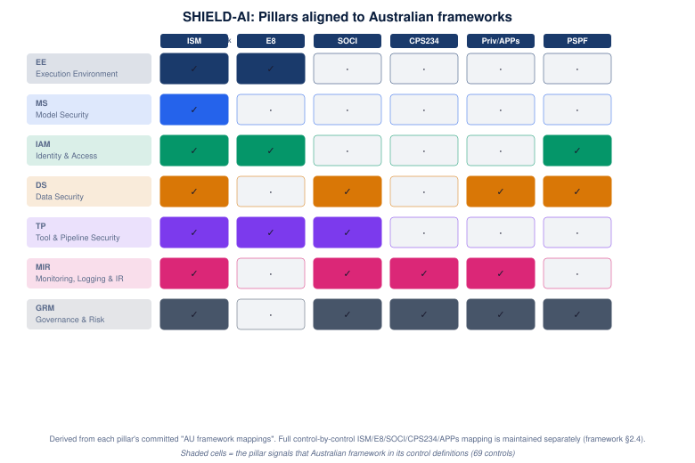

# 03 · Controls → Australian Frameworks

How SHIELD-AI pillars map to the Australian frameworks and regulatory instruments an
organisation must comply with — ISM, Essential Eight, SOCI Act, APRA CPS 234, the Privacy
Act (APPs), and the Protective Security Policy Framework (PSPF). Shaded cells mark the
framework each pillar signals in its committed control definitions.

## Per-pillar AU framework mappings

### EE — Execution Environment

ISM (Guidelines for gateways, system hardening, system management), ASD Container Security Guidance, Essential Eight (Application Control, Restrict Administrative Privileges), ISM (Guidelines for network management -- network segmentation)

### MS — Model Security

ISM (Guidelines for system hardening, procurement guidelines, system management), ISM "Guidelines for secure AI system development" (March 2026 edition), ASD supply chain guidance for AI/ML (March 2026)

### IAM — Identity & Access

ISM (Guidelines for system management -- privileged access, user identification and authentication), Essential Eight (Restrict Administrative Privileges, Multi-factor Authentication, User Application Hardening), PSPF (Personnel Security, Information Security -- access control)

### DS — Data Security

Privacy Act 1988 (APP 11 -- security of personal information, APP 5 -- collection, APP 6 -- use and disclosure), ISM (Guidelines for data transfers, media, cryptography), SOCI Act (CIRMP data protection obligations), PSPF (Information Security -- sensitive and classified information)

### TP — Tool & Pipeline Security

ISM (Guidelines for gateways, networking, software development, system management), Essential Eight (Patch Applications, Patch Operating Systems, Application Control), SOCI Act (CIRMP technology security obligations)

### MIR — Monitoring, Logging & IR

SOCI Act (s.30B mandatory incident reporting -- 12 hours for critical, 72 hours for other), APRA CPS 234 (s.3(c) incident notification within 72 hours), ISM (Guidelines for system monitoring, cyber security incidents), Privacy Act (Notifiable Data Breaches scheme)

### GRM — Governance & Risk

APRA CPS 234 (s.2 Board accountability for information security), PSPF (Security Governance -- Policy 1, Policy 2, Policy 8), SOCI Act (CIRMP governance obligations), Privacy Act (APP 1 -- accountability, APP 12 -- access to information), ISM (Guidelines for cyber security roles, documentation)

## Notes

- The framework (§2.4) maintains a **control-by-control** ISM / E8 / SOCI / CPS 234 /
  Privacy Act map as a separate reference document; this view is the pillar-level
  simplification for stakeholder presentation.
- **MIR** is the most regulation-bound pillar: SOCI s.30B mandatory reporting (12h critical,
  72h other), APRA CPS 234 s.3(c), and the Notifiable Data Breaches scheme all land there.
