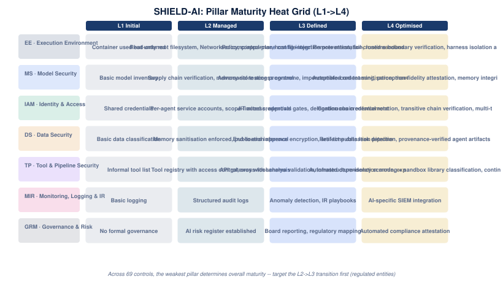

# 04 · Pillars & Controls → Maturity Model

Where each pillar sits on the SHIELD-AI maturity curve (**L1 Initial → L2 Managed → L3
Defined → L4 Optimised**), consistent with ISM and the Essential Eight maturity model.
The weakest pillar determines the organisation's overall maturity score.

## Progression by pillar

| Pillar | L1 | L2 | L3 | L4 |
|---|---|---|---|---|
| **EE** | Container used but untuned | Read-only root filesystem, NetworkPolicy, control-plane config integrity | seccomp/apparmor, host file-injection prevention, fail-closed sandbox operation, eval-harness verification | Remote attestation, runtime boundary verification, harness isolation attestation |
| **MS** | Basic model inventory | Supply chain verification, memory-store access control | Adversarial testing programme, imperceptible-content sanitisation, memory tamper detection | Automated red-teaming, perception-fidelity attestation, memory integrity attestation |
| **IAM** | Shared credentials | Per-agent service accounts, scope-limited credentials | JIT access, approval gates, delegation chain enforcement | Continuous credential rotation, transitive chain verification, multi-tenant isolation |
| **DS** | Basic data classification | Memory sanitisation enforced, publication approval | End-to-end inference encryption, artifact publication pipeline | Real-time data leak detection, provenance-verified agent artifacts |
| **TP** | Informal tool list | Tool registry with access control, cross-tool analysis | API gateway with schema validation, infrastructure-isolation mode, explicit tool registration, inbound binding policy, browser/content-rendering isolation | Automated dependency scanning + sandbox library classification, continuous inbound-surface and rendering-layer testing |
| **MIR** | Basic logging | Structured audit logs | Anomaly detection, IR playbooks | AI-specific SIEM integration |
| **GRM** | No formal governance | AI risk register established | Board reporting, regulatory mapping | Automated compliance attestation |

## Practical guidance

- Move from **L1 → L2** first (documented controls, per-agent identities, basic monitoring).
- Regulated entities and government target **L3** (automated controls, anomaly detection,
  board reporting, full regulatory mapping).
- **L4** (optimised) applies to critical infrastructure and national-security workloads.
