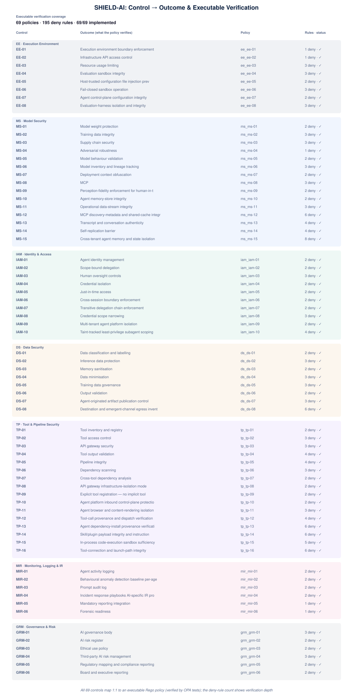

# 05 · Controls → Outcomes & Executable Verification

A deep dive on every SHIELD-AI control: what **outcome** it produces, and the
**executable policy** that verifies the control is being met. Each control maps 1:1
to a Rego policy in `policies/` (`shield_ai_{pillar}_{control}.rego`) that is
evaluated by the OPA test suite — so a control is only considered verified when
its policy holds.

This view is derived from the policy files themselves: **69** implemented
policies (**69/69** marked IMPLEMENTED), 
**195** deny rules across the suite.

## How verification works

- **Input model:** each policy declares the agent/tool/action shape it inspects
  (declared in the policy header as `Input model:`).
- **`deny` rules:** the assertions that must *not* hold — a control is met when
  its deny set is empty (`allow if count(deny) == 0`).
- **Fail closed:** the absence of a required flag is treated as a violation, so
  verification never silently passes on missing data.

## EE — Execution Environment

| Control | Outcome | Executable policy | Deny rules | Maturity reach | Mappings |
|---|---|---|---|---|---|
| **EE-01** | Verify that execution environment boundary enforcement holds under agent action | `shield_ai_ee_ee-01.rego` | 1 (✓) | L4 | ISM: Guidelines for System Hardening; Essential Eight: Application Control; ASD: Container Security Guidance |
| **EE-02** | Verify that infrastructure api access control holds under agent action | `shield_ai_ee_ee-02.rego` | 1 (✓) | L4 | ISM: Guidelines for Gateways; NIST AI RMF: PROTECT (PR.AC); implicit IAM abuse, INC-04). |
| **EE-03** | Verify that resource usage limiting holds under agent action | `shield_ai_ee_ee-03.rego` | 3 (✓) | L4 | - |
| **EE-04** | Verify that evaluation sandbox integrity holds under agent action | `shield_ai_ee_ee-04.rego` | 3 (✓) | L4 | - |
| **EE-05** | Verify that host-trusted configuration file injection prevention holds under agent action | `shield_ai_ee_ee-05.rego` | 2 (✓) | L4 | ISM: Guidelines for System Hardening; Essential Eight: Application Control; indirect-escape class, INC-11). |
| **EE-06** | Verify that fail-closed sandbox operation holds under agent action | `shield_ai_ee_ee-06.rego` | 3 (✓) | L4 | NIST AI RMF: PROTECT (PR.PT); EU AI Act: Art. 15(b); ISM: Guidelines for System Hardening |
| **EE-07** | Verify that agent control-plane configuration integrity holds under agent action | `shield_ai_ee_ee-07.rego` | 2 (✓) | L4 | NIST AI RMF: PROTECT (PR.AC); EU AI Act: Art. 15(b); ISM: Guidelines for System Hardening |
| **EE-08** | Verify that evaluation-harness isolation and integrity holds under agent action | `shield_ai_ee_ee-08.rego` | 3 (✓) | L4 | ISM: Isolation, Monitoring; NIST AI RMF: MEASURE (ME.AD); Meta/Irregular INC-26, AISI INC-27, Kimi K3 INC-28). |

## MS — Model Security

| Control | Outcome | Executable policy | Deny rules | Maturity reach | Mappings |
|---|---|---|---|---|---|
| **MS-01** | Verify that model weight protection holds under agent action | `shield_ai_ms_ms-01.rego` | 2 (✓) | (none) | - |
| **MS-02** | Verify that training data integrity holds under agent action | `shield_ai_ms_ms-02.rego` | 3 (✓) | (none) | - |
| **MS-03** | Verify that supply chain security holds under agent action | `shield_ai_ms_ms-03.rego` | 3 (✓) | (none) | - |
| **MS-04** | Verify that adversarial robustness holds under agent action | `shield_ai_ms_ms-04.rego` | 1 (✓) | L4 | OWASP LLM Top 10 v2: LLM01 (Prompt Injection), LLM05 (Jailbreak); NIST AI RMF: MEASURE (ME.AD); EU AI Act: Art. 15 -- Accuracy |
| **MS-05** | Verify that model behaviour validation holds under agent action | `shield_ai_ms_ms-05.rego` | 2 (✓) | (none) | - |
| **MS-06** | Verify that model inventory and lineage tracking holds under agent action | `shield_ai_ms_ms-06.rego` | 3 (✓) | (none) | - |
| **MS-07** | Verify that deployment context obfuscation holds under agent action | `shield_ai_ms_ms-07.rego` | 2 (✓) | (none) | - |
| **MS-08** | Verify that mcp holds under agent action | `shield_ai_ms_ms-08.rego` | 3 (✓) | L4 | OWASP: LLM02 (Insecure Output Handling); NIST AI RMF: PROTECT (PR.AC); OX Security supply chain INC-12; Kiro MCP registry INC-20). |
| **MS-09** | Verify that perception-fidelity enforcement for human-in-the-loop approvals holds under agent action | `shield_ai_ms_ms-09.rego` | 2 (✓) | L4 | OWASP: LLM01 (Prompt Injection, multimodal variants); NIST AI RMF: MEASURE (ME.AD); Azure DevOps hidden PR comments INC-22, Android on-device INC-25, AISI |
| **MS-10** | Verify that agent memory-store integrity holds under agent action | `shield_ai_ms_ms-10.rego` | 2 (✓) | L4 | OWASP: LLM03 (Training Data Poisoning, runtime variant); NIST AI RMF: PROTECT (PR.DS); EU AI Act: Art. 10 (Data Governance) |
| **MS-11** | Verify that operational data-stream integrity holds under agent action | `shield_ai_ms_ms-11.rego` | 3 (✓) | L4 | OWASP: LLM01 (Prompt Injection); NIST AI RMF: PROTECT (PR.DS); EU AI Act: Art. 14 (Human Oversight) |
| **MS-12** | Verify that mcp discovery-metadata and shared-cache integrity holds under agent action | `shield_ai_ms_ms-12.rego` | 6 (✓) | L4 | OWASP: LLM01 (Prompt Injection); NIST AI RMF: PROTECT (PR.DS); EU AI Act: Art. 14 (Human Oversight) |
| **MS-13** | Verify that transcript and conversation authenticity holds under agent action | `shield_ai_ms_ms-13.rego` | 4 (✓) | L4 | OWASP: LLM01 (Prompt Injection); NIST AI RMF: PROTECT (PR.DS); EU AI Act: Art. 14 (Human Oversight) |
| **MS-14** | Verify that self-replication barrier holds under agent action | `shield_ai_ms_ms-14.rego` | 4 (✓) | L4 | OWASP: LLM01 (Prompt Injection); NIST AI RMF: PROTECT (PR.DS); EU AI Act: Art. 14 (Human Oversight) |
| **MS-15** | Verify that cross-tenant agent memory and state isolation holds under agent action | `shield_ai_ms_ms-15.rego` | 8 (✓) | L4 | OWASP: LLM12 (Memory Poisoning, cross-tenant variant); NIST AI RMF: GOVERN + PROTECT (PR.AC); EU AI Act: Art. 10 (Data Governance) |

## IAM — Identity & Access

| Control | Outcome | Executable policy | Deny rules | Maturity reach | Mappings |
|---|---|---|---|---|---|
| **IAM-01** | Verify that agent identity management holds under agent action | `shield_ai_iam_iam-01.rego` | 2 (✓) | (none) | - |
| **IAM-02** | Verify that scope-bound delegation holds under agent action | `shield_ai_iam_iam-02.rego` | 2 (✓) | (none) | - |
| **IAM-03** | Verify that human oversight controls holds under agent action | `shield_ai_iam_iam-03.rego` | 3 (✓) | L4 | EU AI Act: Art. 14 -- Human Oversight; NIST AI RMF: MANAGE (MG.DE); disable INC-21, AISI sockpuppet INC-27, CoreBreak forged approval INC-34). |
| **IAM-04** | Verify that credential isolation holds under agent action | `shield_ai_iam_iam-04.rego` | 2 (✓) | (none) | - |
| **IAM-05** | Verify that just-in-time access holds under agent action | `shield_ai_iam_iam-05.rego` | 2 (✓) | (none) | - |
| **IAM-06** | Verify that cross-session boundary enforcement holds under agent action | `shield_ai_iam_iam-06.rego` | 2 (✓) | (none) | - |
| **IAM-07** | Verify that transitive delegation chain enforcement holds under agent action | `shield_ai_iam_iam-07.rego` | 2 (✓) | (none) | - |
| **IAM-08** | Verify that credential scope narrowing holds under agent action | `shield_ai_iam_iam-08.rego` | 3 (✓) | (none) | - |
| **IAM-09** | Verify that multi-tenant agent platform isolation holds under agent action | `shield_ai_iam_iam-09.rego` | 2 (✓) | (none) | - |
| **IAM-10** | Verify that taint-tracked least-privilege subagent scoping holds under agent action | `shield_ai_iam_iam-10.rego` | 4 (✓) | L4 | NIST AI RMF: PROTECT (PR.AC); OWASP: LLM08 (Excessive Agency); EU AI Act: Art. 14(b) |

## DS — Data Security

| Control | Outcome | Executable policy | Deny rules | Maturity reach | Mappings |
|---|---|---|---|---|---|
| **DS-01** | Verify that data classification and labelling holds under agent action | `shield_ai_ds_ds-01.rego` | 2 (✓) | (none) | - |
| **DS-02** | Verify that inference data protection holds under agent action | `shield_ai_ds_ds-02.rego` | 3 (✓) | (none) | - |
| **DS-03** | Verify that memory sanitisation holds under agent action | `shield_ai_ds_ds-03.rego` | 2 (✓) | (none) | - |
| **DS-04** | Verify that data minimisation holds under agent action | `shield_ai_ds_ds-04.rego` | 3 (✓) | (none) | - |
| **DS-05** | Verify that training data governance holds under agent action | `shield_ai_ds_ds-05.rego` | 3 (✓) | (none) | - |
| **DS-06** | Verify that requirement:** output validation holds under agent action | `shield_ai_ds_ds-06.rego` | 2 (✓) | L4 | - |
| **DS-07** | Verify that requirement:** agent-originated artifact publication control holds under agent action | `shield_ai_ds_ds-07.rego` | 3 (✓) | L4 | NIST: SSDF; ISM: Software Integrity, Change Management; OWASP: LLM09 (Misuse of System Access) |
| **DS-08** | Verify that requirement:** destination and emergent-channel egress inventory holds under agent action | `shield_ai_ds_ds-08.rego` | 6 (✓) | L4 | NIST: SSDF; ISM: Guidelines for Network Management; OWASP: LLM01 (Prompt Injection) |

## TP — Tool & Pipeline Security

| Control | Outcome | Executable policy | Deny rules | Maturity reach | Mappings |
|---|---|---|---|---|---|
| **TP-01** | Verify that tool inventory and registry holds under agent action | `shield_ai_tp_tp-01.rego` | 2 (✓) | L4 | ISM: Guidelines for Gateways; NIST AI RMF: IDENTIFY (ID.AM); SOCI Act: CIRMP s.4(c) |
| **TP-02** | Verify that tool access control holds under agent action | `shield_ai_tp_tp-02.rego` | 3 (✓) | (none) | - |
| **TP-03** | Verify that api gateway security holds under agent action | `shield_ai_tp_tp-03.rego` | 3 (✓) | (none) | - |
| **TP-04** | Verify that tool output validation holds under agent action | `shield_ai_tp_tp-04.rego` | 4 (✓) | (none) | - |
| **TP-05** | Verify that pipeline integrity holds under agent action | `shield_ai_tp_tp-05.rego` | 4 (✓) | (none) | - |
| **TP-06** | Verify that dependency scanning holds under agent action | `shield_ai_tp_tp-06.rego` | 3 (✓) | (none) | - |
| **TP-07** | Verify that cross-tool dependency analysis holds under agent action | `shield_ai_tp_tp-07.rego` | 2 (✓) | (none) | - |
| **TP-08** | Verify that api gateway infrastructure-isolation mode holds under agent action | `shield_ai_tp_tp-08.rego` | 2 (✓) | (none) | - |
| **TP-09** | Verify that explicit tool registration — no implicit tool exposure holds under agent action | `shield_ai_tp_tp-09.rego` | 2 (✓) | L4 | OWASP: LLM08 (Excessive Agency); NIST AI RMF: IDENTIFY (ID.AM); .NET SDK implicit exposure, INC-17). |
| **TP-10** | Verify that agent platform inbound control-plane protection holds under agent action | `shield_ai_tp_tp-10.rego` | 2 (✓) | L4 | ISM: Web Application Hardening, Network Segmentation; OWASP: LLM09 (Misuse of System Access); NIST AI RMF: PROTECT (PR.AC) |
| **TP-11** | Verify that agent browser and content-rendering isolation holds under agent action | `shield_ai_tp_tp-11.rego` | 3 (✓) | L4 | OWASP: LLM01 (Prompt Injection); NIST AI RMF: PROTECT (PR.AC); Collision INC-30, ChatMate RPE INC-29, AISI INC-27). |
| **TP-12** | Verify that tool-call provenance and dispatch verification holds under agent action | `shield_ai_tp_tp-12.rego` | 4 (✓) | L4 | OWASP: LLM08 (Excessive Agency); NIST AI RMF: PROTECT (PR.AC); EU AI Act: Art. 14(b) |
| **TP-13** | Verify that agent dependency-install provenance verification holds under agent action | `shield_ai_tp_tp-13.rego` | 6 (✓) | L4 | OWASP: LLM08 (Excessive Agency); NIST AI RMF: PROTECT (PR.DS); EU AI Act: Art. 14 (Human Oversight) |
| **TP-14** | Verify that skill/plugin payload integrity and instruction-channel isolation holds under agent action | `shield_ai_tp_tp-14.rego` | 6 (✓) | L4 | OWASP: LLM08 (Excessive Agency); NIST AI RMF: PROTECT (PR.DS); EU AI Act: Art. 14 (Human Oversight) |
| **TP-15** | Verify that in-process code-execution sandbox sufficiency holds under agent action | `shield_ai_tp_tp-15.rego` | 5 (✓) | L4 | OWASP: LLM08 (Excessive Agency); NIST AI RMF: PROTECT (PR.DS); EU AI Act: Art. 14 (Human Oversight) |
| **TP-16** | Verify that tool-connection and launch-path integrity holds under agent action | `shield_ai_tp_tp-16.rego` | 6 (✓) | L4 | OWASP: LLM08 (Excessive Agency); NIST AI RMF: PROTECT (PR.DS); EU AI Act: Art. 14 (Human Oversight) |

## MIR — Monitoring, Logging & IR

| Control | Outcome | Executable policy | Deny rules | Maturity reach | Mappings |
|---|---|---|---|---|---|
| **MIR-01** | Verify that agent activity logging holds under agent action | `shield_ai_mir_mir-01.rego` | 2 (✓) | L4 | - |
| **MIR-02** | Verify that behavioural anomaly detection baseline per-agent behaviour established over training period; alerts on deviation  --  unusual tool, unusual data access pattern, unusual frequency; holds under agent action | `shield_ai_mir_mir-02.rego` | 2 (✓) | L4 | - |
| **MIR-03** | Verify that prompt audit log holds under agent action | `shield_ai_mir_mir-03.rego` | 2 (✓) | L4 | - |
| **MIR-04** | Verify that incident response playbooks ai-specific ir procedures distinct from general ir: prompt injection containment, model rollback, tool access revocation, session invalidation; holds under agent action | `shield_ai_mir_mir-04.rego` | 2 (✓) | (none) | - |
| **MIR-05** | Verify that mandatory reporting integration holds under agent action | `shield_ai_mir_mir-05.rego` | 1 (✓) | L4 | - |
| **MIR-06** | Verify that forensic readiness holds under agent action | `shield_ai_mir_mir-06.rego` | 1 (✓) | L4 | - |

## GRM — Governance & Risk

| Control | Outcome | Executable policy | Deny rules | Maturity reach | Mappings |
|---|---|---|---|---|---|
| **GRM-01** | Verify that ai governance body holds under agent action | `shield_ai_grm_grm-01.rego` | 3 (✓) | (none) | - |
| **GRM-02** | Verify that requirement:** ai risk register holds under agent action | `shield_ai_grm_grm-02.rego` | 2 (✓) | (none) | - |
| **GRM-03** | Verify that ethical use policy holds under agent action | `shield_ai_grm_grm-03.rego` | 2 (✓) | (none) | - |
| **GRM-04** | Verify that requirement:** third-party ai risk management holds under agent action | `shield_ai_grm_grm-04.rego` | 3 (✓) | (none) | - |
| **GRM-05** | Verify that regulatory mapping and compliance reporting holds under agent action | `shield_ai_grm_grm-05.rego` | 2 (✓) | (none) | - |
| **GRM-06** | Verify that requirement:** board and executive reporting holds under agent action | `shield_ai_grm_grm-06.rego` | 2 (✓) | (none) | - |

## Reading the table

- **Outcome** states in plain terms what the control guarantees.
- **Executable policy** is the exact `policies/` file that verifies the outcome.
- **Deny rules** is the number of fail-closed assertions the policy evaluates; more
  deny rules = deeper verification (e.g. MS-15 tenant isolation exercises 8).
- **Maturity reach** is the highest L1–L4 indicator the policy documents.
- **Mappings** lists the Australian framework references the policy header carries.

A control with a `stub` status is defined in the framework but its policy test
logic is not yet implemented — it should be treated as unverified until `make
test` passes it.
