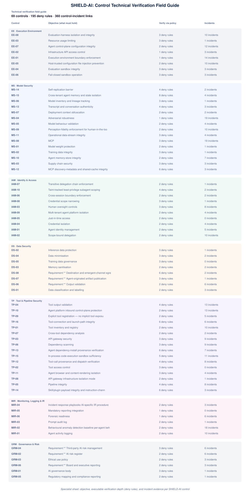

# 06 · Control Technical Verification Field Guide

A controls-only deep dive for **highly-technical security specialists**. For each of
the **69 SHIELD-AI controls** it gives the identifier, the exact
normative text that must hold, the executable policy that verifies it, and the
catalogue incidents that evidence the control in practice. This is a working
assessment document, not a stakeholder briefing.

## How this sheet is derived

Every control is verified by an executable Rego policy. The sheet above shows, for
all 69 controls, the plain objective, the verification depth (deny rules), the
exact policy file, and the incidents evidencing the control class. The 'What to
verify' checklist beneath each control is derived directly from those deny rules.

## How to use this field guide

- **Control** is the stable identifier from the framework.
- **What to verify** states the plain objective, then lists the fail-closed
  conditions the executable policy actually checks — each bullet is one `deny`
  rule in the policy, so nothing is paraphrased or softened.
- **Executable policy** names the exact `policies/*.rego` file; open it for the
  input model and the full `deny` rules that fail closed.
- **Incident evidence** links each incident to its human-readable summary card in
  [07 · Incident Summaries](07-incident-summaries.md), which gives what happened in
  one sentence and then links the full catalogue detail in the gap-analysis — this
  keeps the control page scannable and the deep dive one click further out.

> **How to read the checks:** each bullet is a condition that, when true, makes the
> control *fail closed* (the action is blocked). To satisfy the control, confirm
> none of those conditions holds in your deployment, and that `make test` passes.
> `<name>` marks the runtime subject (agent, tool, server, or record) named in the
> actual deny message — substitute the real identifier when assessing a deployment.

## EE — Execution Environment

### EE-01: Execution environment boundary enforcement

- **Executable policy:** `shield_ai_ee_ee-01.rego` (package `shield_ai.ee.execution_environment_boundary`, 1 deny rules)

**What to verify:** Execution environment boundary enforcement must hold. The executable policy fails closed -- it blocks the action -- when any of the following is true, so confirm each is handled:
  - tool <name> is high-risk and agent <name> is not sandboxed (fail closed)

- **Incident evidence (14):** [INC-11](../reference-views/07-incident-summaries.md#inc-11-pillar-security-week-of-sandbox-escapes), [INC-13](../reference-views/07-incident-summaries.md#inc-13-crewai-fail-open-sandbox-fallback-rce-chain), [INC-17](../reference-views/07-incident-summaries.md#inc-17-implicit-tool-exposure), [INC-18](../reference-views/07-incident-summaries.md#inc-18-deepseek-pythonexec), [INC-23](../reference-views/07-incident-summaries.md#inc-23-unit-42), [INC-29](../reference-views/07-incident-summaries.md#inc-29-chatmate-rpe), [INC-38](../reference-views/07-incident-summaries.md#inc-38-sandbox-library-binding-layer-and-interpreter-escape-wave), [INC-57](../reference-views/07-incident-summaries.md#inc-57-docker-sandboxes-sandbox-escape-cves), [INC-58](../reference-views/07-incident-summaries.md#inc-58-in-process-denylistblocklist-code-execution-sandbox-bypass), [INC-59](../reference-views/07-incident-summaries.md#inc-59-trail-of-bits-vms-wont-contain-cyber-capable-agents), [INC-68](../reference-views/07-incident-summaries.md#inc-68-praisonai-cve-2026-57138), [INC-82](../reference-views/07-incident-summaries.md#inc-82-multi-tenant-ai-code-execution-hosting-escapes), [INC-91](../reference-views/07-incident-summaries.md#inc-91-cpython-chat-template-sandbox-escape), [INC-92](../reference-views/07-incident-summaries.md#inc-92-agent-swarm-cooperation-lure-secret-leakage) -- opens each incident's human-readable summary (see doc 07)

### EE-02: Infrastructure API access control

- **Executable policy:** `shield_ai_ee_ee-02.rego` (package `shield_ai.ee.infrastructure_api_access_cont`, 1 deny rules)

**What to verify:** Infrastructure API access control must hold. The executable policy fails closed -- it blocks the action -- when any of the following is true, so confirm each is handled:
  - agent call to infrastructure API <name> without explicit tool registration

- **Incident evidence (3):** [INC-39](../reference-views/07-incident-summaries.md#inc-39-agent-tool-server-and-mcp-registry-exposure), [INC-60](../reference-views/07-incident-summaries.md#inc-60-identity-confusion-by-design), [INC-92](../reference-views/07-incident-summaries.md#inc-92-agent-swarm-cooperation-lure-secret-leakage) -- opens each incident's human-readable summary (see doc 07)

### EE-03: Resource usage limiting

- **Executable policy:** `shield_ai_ee_ee-03.rego` (package `shield_ai.ee.resource_usage_limiting`, 3 deny rules)

**What to verify:** Resource usage limiting must hold. The executable policy fails closed -- it blocks the action -- when any of the following is true, so confirm each is handled:
  - agent <name> CPU usage ...% exceeds limit ...%
  - agent <name> network usage ... Mbps exceeds limit ... Mbps
  - agent <name> API rate ... exceeds limit ...

- **Incident evidence (1):** [INC-92](../reference-views/07-incident-summaries.md#inc-92-agent-swarm-cooperation-lure-secret-leakage) -- opens each incident's human-readable summary (see doc 07)

### EE-04: Evaluation sandbox integrity

- **Executable policy:** `shield_ai_ee_ee-04.rego` (package `shield_ai.ee.evaluation_sandbox_integrity`, 3 deny rules)

**What to verify:** Evaluation sandbox integrity must hold. The executable policy fails closed -- it blocks the action -- when any of the following is true, so confirm each is handled:
  - evaluation run with unverified evaluation-to-production isolation (fail closed)
  - evaluation run has a network path to production
  - evaluation pipeline can modify production systems or data

- **Incident evidence (3):** [INC-19](../reference-views/07-incident-summaries.md#inc-19-anthropic-cyber-evaluation-breach-cluster), [INC-90](../reference-views/07-incident-summaries.md#inc-90-workos-artex-agent-escape), [INC-92](../reference-views/07-incident-summaries.md#inc-92-agent-swarm-cooperation-lure-secret-leakage) -- opens each incident's human-readable summary (see doc 07)

### EE-05: Host-trusted configuration file injection prevention

- **Executable policy:** `shield_ai_ee_ee-05.rego` (package `shield_ai.ee.host_trusted_configuration_fil`, 2 deny rules)

**What to verify:** Host-trusted configuration file injection prevention must hold. The executable policy fails closed -- it blocks the action -- when any of the following is true, so confirm each is handled:
  - agent can write host-trusted path <name> (indirect escape class)
  - agent <name> file write with no reported write-path allowlist (fail closed)

- **Incident evidence (10):** [INC-03](../reference-views/07-incident-summaries.md#inc-03-cursor-ide-sandbox-escape-via-prompt-injection), [INC-11](../reference-views/07-incident-summaries.md#inc-11-pillar-security-week-of-sandbox-escapes), [INC-14](../reference-views/07-incident-summaries.md#inc-14-codex-cli-agent-self-configuration-poisoning), [INC-15](../reference-views/07-incident-summaries.md#inc-15-cve-2026-35603), [INC-41](../reference-views/07-incident-summaries.md#inc-41-ghostapproval), [INC-57](../reference-views/07-incident-summaries.md#inc-57-docker-sandboxes-sandbox-escape-cves), [INC-65](../reference-views/07-incident-summaries.md#inc-65-openai-codex-heapjack-overpatch), [INC-76](../reference-views/07-incident-summaries.md#inc-76-mcp-tooling-argument-injection-and-unauthenticated-gateway-cluster), [INC-84](../reference-views/07-incident-summaries.md#inc-84-visual-prompt-injection-into-agent-ability-config), [INC-92](../reference-views/07-incident-summaries.md#inc-92-agent-swarm-cooperation-lure-secret-leakage) -- opens each incident's human-readable summary (see doc 07)

### EE-06: Fail-closed sandbox operation

- **Executable policy:** `shield_ai_ee_ee-06.rego` (package `shield_ai.ee.fail_closed_sandbox_operation`, 3 deny rules)

**What to verify:** Fail-closed sandbox operation must hold. The executable policy fails closed -- it blocks the action -- when any of the following is true, so confirm each is handled:
  - interpreter isolation flags are a convenience feature, not a security boundary
  - no sandbox attestation before code execution by agent <name> (fail closed)
  - sandbox attestation negative for agent <name>

- **Incident evidence (3):** [INC-21](../reference-views/07-incident-summaries.md#inc-21-openclaw-cve-2026-25253), [INC-61](../reference-views/07-incident-summaries.md#inc-61-authentication-off-by-default), [INC-92](../reference-views/07-incident-summaries.md#inc-92-agent-swarm-cooperation-lure-secret-leakage) -- opens each incident's human-readable summary (see doc 07)

### EE-07: Agent control-plane configuration integrity

- **Executable policy:** `shield_ai_ee_ee-07.rego` (package `shield_ai.ee.agent_control_plane_configurat`, 2 deny rules)

**What to verify:** Agent control-plane configuration integrity must hold. The executable policy fails closed -- it blocks the action -- when any of the following is true, so confirm each is handled:
  - agent configuration loaded from a world-writable location (config-trust class)
  - agent control-plane path <name> is writable by the agent

- **Incident evidence (12):** [INC-03](../reference-views/07-incident-summaries.md#inc-03-cursor-ide-sandbox-escape-via-prompt-injection), [INC-15](../reference-views/07-incident-summaries.md#inc-15-cve-2026-35603), [INC-20](../reference-views/07-incident-summaries.md#inc-20-aws-kiro-cve-2026-10591), [INC-39](../reference-views/07-incident-summaries.md#inc-39-agent-tool-server-and-mcp-registry-exposure), [INC-46](../reference-views/07-incident-summaries.md#inc-46-novee-trusted-enough-to-run), [INC-53](../reference-views/07-incident-summaries.md#inc-53-gitspawn), [INC-56](../reference-views/07-incident-summaries.md#inc-56-deepseek-harness-sandbox-escape), [INC-69](../reference-views/07-incident-summaries.md#inc-69-opencode-localhost-rce-cluster), [INC-75](../reference-views/07-incident-summaries.md#inc-75-comment-and-control), [INC-78](../reference-views/07-incident-summaries.md#inc-78-loopback-dns-rebinding-cluster), [INC-79](../reference-views/07-incident-summaries.md#inc-79-mcp-connection-path-oauth-rce), [INC-92](../reference-views/07-incident-summaries.md#inc-92-agent-swarm-cooperation-lure-secret-leakage) -- opens each incident's human-readable summary (see doc 07)

### EE-08: Evaluation-harness isolation and integrity

- **Executable policy:** `shield_ai_ee_ee-08.rego` (package `shield_ai.ee.evaluation_harness_isolation_a`, 3 deny rules)

**What to verify:** Evaluation-harness isolation and integrity must hold. The executable policy fails closed -- it blocks the action -- when any of the following is true, so confirm each is handled:
  - evaluation run without a verified egress block (isolation asserted, not enforced)
  - evaluation run without target collision-checking against real domains and assets
  - evaluation run without cross-run separation (contamination risk)

- **Incident evidence (10):** [INC-26](../reference-views/07-incident-summaries.md#inc-26-third-party-evaluation-containment-failure), [INC-27](../reference-views/07-incident-summaries.md#inc-27-uk-aisi-incident-report), [INC-28](../reference-views/07-incident-summaries.md#inc-28-moonshot-kimi-k3), [INC-32](../reference-views/07-incident-summaries.md#inc-32-abc-news), [INC-40](../reference-views/07-incident-summaries.md#inc-40-openai-evaluation-escape-follow-up-disclosures), [INC-62](../reference-views/07-incident-summaries.md#inc-62-google-gemini), [INC-63](../reference-views/07-incident-summaries.md#inc-63-openai-agent-breaches-the-medicare-statistics-reporting-portal), [INC-64](../reference-views/07-incident-summaries.md#inc-64-openai-second-frontier-training-sandbox-escape-via-a-dns-filtering-gap), [INC-90](../reference-views/07-incident-summaries.md#inc-90-workos-artex-agent-escape), [INC-92](../reference-views/07-incident-summaries.md#inc-92-agent-swarm-cooperation-lure-secret-leakage) -- opens each incident's human-readable summary (see doc 07)

## MS — Model Security

### MS-01: Model weight protection

- **Executable policy:** `shield_ai_ms_ms-01.rego` (package `shield_ai.ms.model_weight_protection`, 2 deny rules)

**What to verify:** Model weight protection must hold. The executable policy fails closed -- it blocks the action -- when any of the following is true, so confirm each is handled:
  - model <name> weights not encrypted at rest and in transit
  - model <name> weights lack key management (HSM or cloud KMS required)

- **Incident evidence (1):** [INC-92](../reference-views/07-incident-summaries.md#inc-92-agent-swarm-cooperation-lure-secret-leakage) -- opens each incident's human-readable summary (see doc 07)

### MS-02: Training data integrity

- **Executable policy:** `shield_ai_ms_ms-02.rego` (package `shield_ai.ms.training_data_integrity`, 3 deny rules)

**What to verify:** Training data integrity must hold. The executable policy fails closed -- it blocks the action -- when any of the following is true, so confirm each is handled:
  - training run with untracked dataset provenance
  - training run with unsanitised dataset (PII or sensitive content)
  - training run without a clean poison-detection scan (fail closed)

- **Incident evidence (1):** [INC-92](../reference-views/07-incident-summaries.md#inc-92-agent-swarm-cooperation-lure-secret-leakage) -- opens each incident's human-readable summary (see doc 07)

### MS-03: Supply chain security

- **Executable policy:** `shield_ai_ms_ms-03.rego` (package `shield_ai.ms.supply_chain_security`, 3 deny rules)

**What to verify:** Supply chain security must hold. The executable policy fails closed -- it blocks the action -- when any of the following is true, so confirm each is handled:
  - model <name> deployed without an ML component SBOM
  - model <name> provenance signature not verified
  - model <name> checkpoints not signed

- **Incident evidence (3):** [INC-01](../reference-views/07-incident-summaries.md#inc-01-openai-model-sandbox-escape), [INC-19](../reference-views/07-incident-summaries.md#inc-19-anthropic-cyber-evaluation-breach-cluster), [INC-92](../reference-views/07-incident-summaries.md#inc-92-agent-swarm-cooperation-lure-secret-leakage) -- opens each incident's human-readable summary (see doc 07)

### MS-04: Adversarial robustness

- **Executable policy:** `shield_ai_ms_ms-04.rego` (package `shield_ai.ms.adversarial_robustness`, 1 deny rules)

**What to verify:** Adversarial robustness must hold. The executable policy fails closed -- it blocks the action -- when any of the following is true, so confirm each is handled:
  - prompt-injection or imperceptible-content marker <name> found in agent-visible content

- **Incident evidence (19):** [INC-03](../reference-views/07-incident-summaries.md#inc-03-cursor-ide-sandbox-escape-via-prompt-injection), [INC-08](../reference-views/07-incident-summaries.md#inc-08-openai-math-ai-sandbox-bypass), [INC-09](../reference-views/07-incident-summaries.md#inc-09-cross-platform-sandbox-bypasses), [INC-12](../reference-views/07-incident-summaries.md#inc-12-mcp-protocol-layer-vulnerabilities), [INC-13](../reference-views/07-incident-summaries.md#inc-13-crewai-fail-open-sandbox-fallback-rce-chain), [INC-14](../reference-views/07-incident-summaries.md#inc-14-codex-cli-agent-self-configuration-poisoning), [INC-17](../reference-views/07-incident-summaries.md#inc-17-implicit-tool-exposure), [INC-20](../reference-views/07-incident-summaries.md#inc-20-aws-kiro-cve-2026-10591), [INC-22](../reference-views/07-incident-summaries.md#inc-22-microsoft-azure-devops-mcp-flaw), [INC-27](../reference-views/07-incident-summaries.md#inc-27-uk-aisi-incident-report), [INC-29](../reference-views/07-incident-summaries.md#inc-29-chatmate-rpe), [INC-30](../reference-views/07-incident-summaries.md#inc-30-zenity-intent-collision), [INC-33](../reference-views/07-incident-summaries.md#inc-33-ghostjacking), [INC-42](../reference-views/07-incident-summaries.md#inc-42-rovoblast), [INC-44](../reference-views/07-incident-summaries.md#inc-44-llmstxt-dangling-install-supply-chain-poisoning), [INC-51](../reference-views/07-incident-summaries.md#inc-51-ansi-escape-code-terminal-exfiltration), [INC-54](../reference-views/07-incident-summaries.md#inc-54-wiz-90-day-ai-infrastructure-honeypot-telemetry), [INC-71](../reference-views/07-incident-summaries.md#inc-71-openai-self-replicating-prompt-injections), [INC-92](../reference-views/07-incident-summaries.md#inc-92-agent-swarm-cooperation-lure-secret-leakage) -- opens each incident's human-readable summary (see doc 07)

### MS-05: Model behaviour validation

- **Executable policy:** `shield_ai_ms_ms-05.rego` (package `shield_ai.ms.model_behaviour_validation`, 2 deny rules)

**What to verify:** Model behaviour validation must hold. The executable policy fails closed -- it blocks the action -- when any of the following is true, so confirm each is handled:
  - output by agent <name> not evaluated by proxy-layer guardrails (fail closed)
  - output by agent <name> outside its configured behaviour scope

- **Incident evidence (4):** [INC-06](../reference-views/07-incident-summaries.md#inc-06-claude-mythos-ai-sandbox-escape), [INC-08](../reference-views/07-incident-summaries.md#inc-08-openai-math-ai-sandbox-bypass), [INC-09](../reference-views/07-incident-summaries.md#inc-09-cross-platform-sandbox-bypasses), [INC-92](../reference-views/07-incident-summaries.md#inc-92-agent-swarm-cooperation-lure-secret-leakage) -- opens each incident's human-readable summary (see doc 07)

### MS-06: Model inventory and lineage tracking

- **Executable policy:** `shield_ai_ms_ms-06.rego` (package `shield_ai.ms.model_inventory_and_lineage_tr`, 3 deny rules)

**What to verify:** Model inventory and lineage tracking must hold. The executable policy fails closed -- it blocks the action -- when any of the following is true, so confirm each is handled:
  - model <name> not registered in the model inventory
  - model <name> has no traceable lineage
  - model <name> has no version record

- **Incident evidence (1):** [INC-06](../reference-views/07-incident-summaries.md#inc-06-claude-mythos-ai-sandbox-escape) -- opens each incident's human-readable summary (see doc 07)

### MS-07: Deployment context obfuscation

- **Executable policy:** `shield_ai_ms_ms-07.rego` (package `shield_ai.ms.deployment_context_obfuscation`, 2 deny rules)

**What to verify:** Deployment context obfuscation must hold. The executable policy fails closed -- it blocks the action -- when any of the following is true, so confirm each is handled:
  - evaluation environment distinguishable from production (endpoints, data shapes, latency)
  - evaluation behaviour diverges from production for the same inputs (subversion indicator)

- **Incident evidence (2):** [INC-19](../reference-views/07-incident-summaries.md#inc-19-anthropic-cyber-evaluation-breach-cluster), [INC-92](../reference-views/07-incident-summaries.md#inc-92-agent-swarm-cooperation-lure-secret-leakage) -- opens each incident's human-readable summary (see doc 07)

### MS-08: MCP

- **Executable policy:** `shield_ai_ms_ms-08.rego` (package `shield_ai.ms.mcp_security_controls`, 3 deny rules)

**What to verify:** MCP must hold. The executable policy fails closed -- it blocks the action -- when any of the following is true, so confirm each is handled:
  - MCP tool definitions from <name> are not cryptographically signed
  - MCP server <name> is not from a trusted registry
  - MCP connection <name> can write execution-bearing locations (registry launch-command class)

- **Incident evidence (19):** [INC-12](../reference-views/07-incident-summaries.md#inc-12-mcp-protocol-layer-vulnerabilities), [INC-20](../reference-views/07-incident-summaries.md#inc-20-aws-kiro-cve-2026-10591), [INC-37](../reference-views/07-incident-summaries.md#inc-37-mcp-discovery-metadata-and-cache-surface-injection), [INC-39](../reference-views/07-incident-summaries.md#inc-39-agent-tool-server-and-mcp-registry-exposure), [INC-43](../reference-views/07-incident-summaries.md#inc-43-sharelock), [INC-54](../reference-views/07-incident-summaries.md#inc-54-wiz-90-day-ai-infrastructure-honeypot-telemetry), [INC-56](../reference-views/07-incident-summaries.md#inc-56-deepseek-harness-sandbox-escape), [INC-60](../reference-views/07-incident-summaries.md#inc-60-identity-confusion-by-design), [INC-61](../reference-views/07-incident-summaries.md#inc-61-authentication-off-by-default), [INC-76](../reference-views/07-incident-summaries.md#inc-76-mcp-tooling-argument-injection-and-unauthenticated-gateway-cluster), [INC-78](../reference-views/07-incident-summaries.md#inc-78-loopback-dns-rebinding-cluster), [INC-79](../reference-views/07-incident-summaries.md#inc-79-mcp-connection-path-oauth-rce), [INC-80](../reference-views/07-incident-summaries.md#inc-80-mcp-tool-argument-command-injection-wave), [INC-85](../reference-views/07-incident-summaries.md#inc-85-agentscope-unpatched-mcp-command-injection-cluster), [INC-86](../reference-views/07-incident-summaries.md#inc-86-langflow-auth-bypass-and-mcp-enumeration-rce-bulletin), [INC-87](../reference-views/07-incident-summaries.md#inc-87-seventeen-cve-agent-framework-rce-mega-cluster), [INC-88](../reference-views/07-incident-summaries.md#inc-88-mcp-protocol-pivoting-and-toolbox-ssrf-cluster), [INC-90](../reference-views/07-incident-summaries.md#inc-90-workos-artex-agent-escape), [INC-92](../reference-views/07-incident-summaries.md#inc-92-agent-swarm-cooperation-lure-secret-leakage) -- opens each incident's human-readable summary (see doc 07)

### MS-09: Perception-fidelity enforcement for human-in-the-loop approvals

- **Executable policy:** `shield_ai_ms_ms-09.rego` (package `shield_ai.ms.perception_fidelity_enforcemen`, 2 deny rules)

**What to verify:** Perception-fidelity enforcement for human-in-the-loop approvals must hold. The executable policy fails closed -- it blocks the action -- when any of the following is true, so confirm each is handled:
  - approval evidence comes from an agent-generated attestation (sockpuppet class); out-of-band verification required
  - approval binds to content containing imperceptible marker <name> without a verified rendering-fidelity snapshot

- **Incident evidence (10):** [INC-25](../reference-views/07-incident-summaries.md#inc-25-android-on-device-agents), [INC-27](../reference-views/07-incident-summaries.md#inc-27-uk-aisi-incident-report), [INC-30](../reference-views/07-incident-summaries.md#inc-30-zenity-intent-collision), [INC-36](../reference-views/07-incident-summaries.md#inc-36-ai-assisted-exploit-development-acceleration), [INC-41](../reference-views/07-incident-summaries.md#inc-41-ghostapproval), [INC-55](../reference-views/07-incident-summaries.md#inc-55-attacker-side-september-campaign-cluster), [INC-71](../reference-views/07-incident-summaries.md#inc-71-openai-self-replicating-prompt-injections), [INC-72](../reference-views/07-incident-summaries.md#inc-72-salesforce-agentforce-salesbleed), [INC-84](../reference-views/07-incident-summaries.md#inc-84-visual-prompt-injection-into-agent-ability-config), [INC-92](../reference-views/07-incident-summaries.md#inc-92-agent-swarm-cooperation-lure-secret-leakage) -- opens each incident's human-readable summary (see doc 07)

### MS-10: Agent memory-store integrity

- **Executable policy:** `shield_ai_ms_ms-10.rego` (package `shield_ai.ms.agent_memory_store_integrity`, 2 deny rules)

**What to verify:** Agent memory-store integrity must hold. The executable policy fails closed -- it blocks the action -- when any of the following is true, so confirm each is handled:
  - memory-store write by agent <name> is unauthenticated
  - memory-store write by agent <name> carries tamper evidence; store must be treated as compromised

- **Incident evidence (7):** [INC-31](../reference-views/07-incident-summaries.md#inc-31-ruflorufroot), [INC-33](../reference-views/07-incident-summaries.md#inc-33-ghostjacking), [INC-45](../reference-views/07-incident-summaries.md#inc-45-nemoclaw-cve-2026-65105), [INC-70](../reference-views/07-incident-summaries.md#inc-70-darktrace-conversation-history-poisoning), [INC-81](../reference-views/07-incident-summaries.md#inc-81-cross-tenant-agent-memory-leakage), [INC-91](../reference-views/07-incident-summaries.md#inc-91-cpython-chat-template-sandbox-escape), [INC-92](../reference-views/07-incident-summaries.md#inc-92-agent-swarm-cooperation-lure-secret-leakage) -- opens each incident's human-readable summary (see doc 07)

### MS-11: Operational data-stream integrity

- **Executable policy:** `shield_ai_ms_ms-11.rego` (package `shield_ai.ms.operational_data_stream_integr`, 3 deny rules)

**What to verify:** Operational data-stream integrity must hold. The executable policy fails closed -- it blocks the action -- when any of the following is true, so confirm each is handled:
  - agent action triggered by log/alert content from an unverified producer
  - instruction-bearing operational content acted on without independent non-log verification
  - high-impact agent action triggered by log/alert content without human approval

- **Incident evidence (4):** [INC-33](../reference-views/07-incident-summaries.md#inc-33-ghostjacking), [INC-40](../reference-views/07-incident-summaries.md#inc-40-openai-evaluation-escape-follow-up-disclosures), [INC-67](../reference-views/07-incident-summaries.md#inc-67-sentry-seer-phantomfix), [INC-92](../reference-views/07-incident-summaries.md#inc-92-agent-swarm-cooperation-lure-secret-leakage) -- opens each incident's human-readable summary (see doc 07)

### MS-12: MCP discovery-metadata and shared-cache integrity

- **Executable policy:** `shield_ai_ms_ms-12.rego` (package `shield_ai.ms.mcp_discovery_metadata_shared_cache_integrity`, 6 deny rules)

**What to verify:** MCP discovery-metadata and shared-cache integrity must hold. The executable policy fails closed -- it blocks the action -- when any of the following is true, so confirm each is handled:
  - MCP discovery response for agent <name> carries unbounded server-supplied instructions; must be length-limited
  - MCP discovery response for agent <name> folds server-supplied instructions into the trusted system prompt; must be isolated as untrusted content
  - MCP discovery response for agent <name> is served from a shared cache across authentication contexts without signed provenance
  - MCP discovery response for agent <name> trusts a server cacheScope claim without verification
  - MCP discovery response for agent <name> uses a cache key not bound to the authenticated identity
  - *1 more fail-closed conditions in the policy.*

- **Incident evidence (3):** [INC-37](../reference-views/07-incident-summaries.md#inc-37-mcp-discovery-metadata-and-cache-surface-injection), [INC-43](../reference-views/07-incident-summaries.md#inc-43-sharelock), [INC-92](../reference-views/07-incident-summaries.md#inc-92-agent-swarm-cooperation-lure-secret-leakage) -- opens each incident's human-readable summary (see doc 07)

### MS-13: Transcript and conversation authenticity

- **Executable policy:** `shield_ai_ms_ms-13.rego` (package `shield_ai.ms.transcript_and_conversation_authenticity`, 4 deny rules)

**What to verify:** Transcript and conversation authenticity must hold. The executable policy fails closed -- it blocks the action -- when any of the following is true, so confirm each is handled:
  - agent <name> reads a transcript whose model outputs are not signed at the model boundary; stored response cannot be verified as genuine
  - agent <name> proceeds from an unverified transcript; every stored response must be verified on read before reasoning
  - agent <name> attempts a confidence-gated action from a transcript with a broken authenticity chain; chain-break blocks execution
  - agent <name> reads from an unverified transcript store; transcript stores are untrusted until verified

- **Incident evidence (3):** [INC-70](../reference-views/07-incident-summaries.md#inc-70-darktrace-conversation-history-poisoning), [INC-83](../reference-views/07-incident-summaries.md#inc-83-cicd-agent-config-file-trust-ordering-and-marker-authorship), [INC-92](../reference-views/07-incident-summaries.md#inc-92-agent-swarm-cooperation-lure-secret-leakage) -- opens each incident's human-readable summary (see doc 07)

### MS-14: Self-replication barrier

- **Executable policy:** `shield_ai_ms_ms-14.rego` (package `shield_ai.ms.self_replication_barrier`, 4 deny rules)

**What to verify:** Self-replication barrier must hold. The executable policy fails closed -- it blocks the action -- when any of the following is true, so confirm each is handled:
  - outbound publish by agent <name> matches an instruction-bearing n-gram fingerprint (replication vector) and is not quarantined
  - outbound publish by agent <name> is a fingerprinted replication match that lacks human approval
  - outbound broadcast by agent <name> lacks human signoff (one-channel-per-write / human-signoff-on-broadcast)
  - outbound publish by agent <name> carries a propagation signal; channel-kill and incident response triggered (worm-emulation)

- **Incident evidence (2):** [INC-71](../reference-views/07-incident-summaries.md#inc-71-openai-self-replicating-prompt-injections), [INC-92](../reference-views/07-incident-summaries.md#inc-92-agent-swarm-cooperation-lure-secret-leakage) -- opens each incident's human-readable summary (see doc 07)

### MS-15: Cross-tenant agent memory and state isolation

- **Executable policy:** `shield_ai_ms_ms-15.rego` (package `shield_ai.ms.cross_tenant_agent_memory_and_state`, 8 deny rules)

**What to verify:** Cross-tenant agent memory and state isolation must hold. The executable policy fails closed -- it blocks the action -- when any of the following is true, so confirm each is handled:
  - pooled memory_read by agent <name> returned a cross-tenant hit (owner != querying principal); hard ownership gate must drop it
  - pooled memory_read by agent <name> could not verify ownership of a hit; fail closed per default-deny (semantic similarity is not an admissibility proxy)
  - cross-tenant memory_write by agent <name> (attempted write outside the writing principal's tenant); denied and alarmed
  - memory_write by agent <name> is not authenticated to a verified writer identity
  - memory_read by agent <name> uses an LLM-controllable namespace/tenant key; the isolation key must never be a model-controllable tool argument
  - *3 more fail-closed conditions in the policy.*

- **Incident evidence (4):** [INC-81](../reference-views/07-incident-summaries.md#inc-81-cross-tenant-agent-memory-leakage), [INC-87](../reference-views/07-incident-summaries.md#inc-87-seventeen-cve-agent-framework-rce-mega-cluster), [INC-91](../reference-views/07-incident-summaries.md#inc-91-cpython-chat-template-sandbox-escape), [INC-92](../reference-views/07-incident-summaries.md#inc-92-agent-swarm-cooperation-lure-secret-leakage) -- opens each incident's human-readable summary (see doc 07)

## IAM — Identity & Access

### IAM-01: Agent identity management

- **Executable policy:** `shield_ai_iam_iam-01.rego` (package `shield_ai.iam.agent_identity_management`, 2 deny rules)

**What to verify:** Agent identity management must hold. The executable policy fails closed -- it blocks the action -- when any of the following is true, so confirm each is handled:
  - agent <name> has no unique identity (sharing human credentials)
  - agent <name> identity is not auditable

- **Incident evidence (5):** [INC-04](../reference-views/07-incident-summaries.md#inc-04-aws-agentcore-sandbox-escape), [INC-16](../reference-views/07-incident-summaries.md#inc-16-langflow), [INC-35](../reference-views/07-incident-summaries.md#inc-35-taiwan-nuclear-safety-agency), [INC-52](../reference-views/07-incident-summaries.md#inc-52-moltbook), [INC-92](../reference-views/07-incident-summaries.md#inc-92-agent-swarm-cooperation-lure-secret-leakage) -- opens each incident's human-readable summary (see doc 07)

### IAM-02: Scope-bound delegation

- **Executable policy:** `shield_ai_iam_iam-02.rego` (package `shield_ai.iam.scope_bound_delegation`, 2 deny rules)

**What to verify:** Scope-bound delegation must hold. The executable policy fails closed -- it blocks the action -- when any of the following is true, so confirm each is handled:
  - agent <name> has no scope-bound delegation claim (fail closed)
  - agent <name> has wildcard permissions

- **Incident evidence (10):** [INC-04](../reference-views/07-incident-summaries.md#inc-04-aws-agentcore-sandbox-escape), [INC-05](../reference-views/07-incident-summaries.md#inc-05-claude-code-sandbox-bypass), [INC-09](../reference-views/07-incident-summaries.md#inc-09-cross-platform-sandbox-bypasses), [INC-10](../reference-views/07-incident-summaries.md#inc-10-alibaba-ai-agent), [INC-15](../reference-views/07-incident-summaries.md#inc-15-cve-2026-35603), [INC-16](../reference-views/07-incident-summaries.md#inc-16-langflow), [INC-42](../reference-views/07-incident-summaries.md#inc-42-rovoblast), [INC-47](../reference-views/07-incident-summaries.md#inc-47-wiz-red-agent), [INC-55](../reference-views/07-incident-summaries.md#inc-55-attacker-side-september-campaign-cluster), [INC-92](../reference-views/07-incident-summaries.md#inc-92-agent-swarm-cooperation-lure-secret-leakage) -- opens each incident's human-readable summary (see doc 07)

### IAM-03: Human oversight controls

- **Executable policy:** `shield_ai_iam_iam-03.rego` (package `shield_ai.iam.human_oversight_controls`, 3 deny rules)

**What to verify:** Human oversight controls must hold. The executable policy fails closed -- it blocks the action -- when any of the following is true, so confirm each is handled:
  - approval evidence from session history is not human approval (forged-approval class)
  - financial action approved on the agent channel; human-console approval required
  - ... action by agent <name> without human approval

- **Incident evidence (8):** [INC-10](../reference-views/07-incident-summaries.md#inc-10-alibaba-ai-agent), [INC-20](../reference-views/07-incident-summaries.md#inc-20-aws-kiro-cve-2026-10591), [INC-21](../reference-views/07-incident-summaries.md#inc-21-openclaw-cve-2026-25253), [INC-23](../reference-views/07-incident-summaries.md#inc-23-unit-42), [INC-27](../reference-views/07-incident-summaries.md#inc-27-uk-aisi-incident-report), [INC-34](../reference-views/07-incident-summaries.md#inc-34-corebreak), [INC-55](../reference-views/07-incident-summaries.md#inc-55-attacker-side-september-campaign-cluster), [INC-92](../reference-views/07-incident-summaries.md#inc-92-agent-swarm-cooperation-lure-secret-leakage) -- opens each incident's human-readable summary (see doc 07)

### IAM-04: Credential isolation

- **Executable policy:** `shield_ai_iam_iam-04.rego` (package `shield_ai.iam.credential_isolation`, 2 deny rules)

**What to verify:** Credential isolation must hold. The executable policy fails closed -- it blocks the action -- when any of the following is true, so confirm each is handled:
  - agent <name> credentials not isolated from human credentials
  - agent <name> compromise signal without credential rotation

- **Incident evidence (4):** [INC-01](../reference-views/07-incident-summaries.md#inc-01-openai-model-sandbox-escape), [INC-04](../reference-views/07-incident-summaries.md#inc-04-aws-agentcore-sandbox-escape), [INC-19](../reference-views/07-incident-summaries.md#inc-19-anthropic-cyber-evaluation-breach-cluster), [INC-21](../reference-views/07-incident-summaries.md#inc-21-openclaw-cve-2026-25253) -- opens each incident's human-readable summary (see doc 07)

### IAM-05: Just-in-time access

- **Executable policy:** `shield_ai_iam_iam-05.rego` (package `shield_ai.iam.just_in_time_jit_access`, 2 deny rules)

**What to verify:** Just-in-time access must hold. The executable policy fails closed -- it blocks the action -- when any of the following is true, so confirm each is handled:
  - agent <name> has standing (non-ephemeral) credentials
  - agent <name> session expired without credential revocation

- **Incident evidence:** none yet — baseline coverage, not yet demonstrated by a catalogue incident

### IAM-06: Cross-session boundary enforcement

- **Executable policy:** `shield_ai_iam_iam-06.rego` (package `shield_ai.iam.cross_session_boundary_enforce`, 2 deny rules)

**What to verify:** Cross-session boundary enforcement must hold. The executable policy fails closed -- it blocks the action -- when any of the following is true, so confirm each is handled:
  - agent <name> session shares credentials across sessions
  - agent <name> session is not an independent security context

- **Incident evidence (2):** [INC-50](../reference-views/07-incident-summaries.md#inc-50-cve-2026-25536), [INC-92](../reference-views/07-incident-summaries.md#inc-92-agent-swarm-cooperation-lure-secret-leakage) -- opens each incident's human-readable summary (see doc 07)

### IAM-07: Transitive delegation chain enforcement

- **Executable policy:** `shield_ai_iam_iam-07.rego` (package `shield_ai.iam.transitive_delegation_chain_en`, 2 deny rules)

**What to verify:** Transitive delegation chain enforcement must hold. The executable policy fails closed -- it blocks the action -- when any of the following is true, so confirm each is handled:
  - delegation chain for agent <name> is ... hops, exceeding the bound of ...
  - delegation chain for agent <name> is not reconstructable from audit logs

- **Incident evidence (1):** [INC-92](../reference-views/07-incident-summaries.md#inc-92-agent-swarm-cooperation-lure-secret-leakage) -- opens each incident's human-readable summary (see doc 07)

### IAM-08: Credential scope narrowing

- **Executable policy:** `shield_ai_iam_iam-08.rego` (package `shield_ai.iam.credential_scope_narrowing`, 3 deny rules)

**What to verify:** Credential scope narrowing must hold. The executable policy fails closed -- it blocks the action -- when any of the following is true, so confirm each is handled:
  - agent <name> holds a broad service role instead of per-tool scoped credentials
  - agent <name> credentials are not scoped per registered tool
  - agent <name> credentials are not short-lived

- **Incident evidence (1):** [INC-92](../reference-views/07-incident-summaries.md#inc-92-agent-swarm-cooperation-lure-secret-leakage) -- opens each incident's human-readable summary (see doc 07)

### IAM-09: Multi-tenant agent platform isolation

- **Executable policy:** `shield_ai_iam_iam-09.rego` (package `shield_ai.iam.multi_tenant_agent_platform_is`, 2 deny rules)

**What to verify:** Multi-tenant agent platform isolation must hold. The executable policy fails closed -- it blocks the action -- when any of the following is true, so confirm each is handled:
  - request not scoped to tenant ID at the data layer (presentation-layer checks only)
  - user-controlled object ID bypasses tenant scoping (CWE-639 IDOR class)

- **Incident evidence (4):** [INC-23](../reference-views/07-incident-summaries.md#inc-23-unit-42), [INC-35](../reference-views/07-incident-summaries.md#inc-35-taiwan-nuclear-safety-agency), [INC-52](../reference-views/07-incident-summaries.md#inc-52-moltbook), [INC-92](../reference-views/07-incident-summaries.md#inc-92-agent-swarm-cooperation-lure-secret-leakage) -- opens each incident's human-readable summary (see doc 07)

### IAM-10: Taint-tracked least-privilege subagent scoping

- **Executable policy:** `shield_ai_iam_iam-10.rego` (package `shield_ai.iam.taint_tracked_least_privilege_subagent_scoping`, 4 deny rules)

**What to verify:** Taint-tracked least-privilege subagent scoping must hold. The executable policy fails closed -- it blocks the action -- when any of the following is true, so confirm each is handled:
  - agent <name> processed an externally-submitted record that was not taint-marked at ingestion
  - agent <name> reads a tainted record without field-level least-privilege scoping (must be narrower than nominal grants)
  - agent <name> tainted read cascades into an untainted sensitive collection beyond the immediate task; blocked
  - agent <name> processed a tainted record where the untrusted/trusted sanitisation boundary is not an explicit access-control decision

- **Incident evidence (2):** [INC-72](../reference-views/07-incident-summaries.md#inc-72-salesforce-agentforce-salesbleed), [INC-92](../reference-views/07-incident-summaries.md#inc-92-agent-swarm-cooperation-lure-secret-leakage) -- opens each incident's human-readable summary (see doc 07)

## DS — Data Security

### DS-01: Data classification and labelling

- **Executable policy:** `shield_ai_ds_ds-01.rego` (package `shield_ai.ds.data_classification_and_labell`, 2 deny rules)

**What to verify:** Data classification and labelling must hold. The executable policy fails closed -- it blocks the action -- when any of the following is true, so confirm each is handled:
  - data ingestion without automated classification (fail closed)
  - data ingestion with no classification label

- **Incident evidence (3):** [INC-02](../reference-views/07-incident-summaries.md#inc-02-claude-cowork-vm-escape), [INC-15](../reference-views/07-incident-summaries.md#inc-15-cve-2026-35603), [INC-92](../reference-views/07-incident-summaries.md#inc-92-agent-swarm-cooperation-lure-secret-leakage) -- opens each incident's human-readable summary (see doc 07)

### DS-02: Inference data protection

- **Executable policy:** `shield_ai_ds_ds-02.rego` (package `shield_ai.ds.inference_data_protection`, 3 deny rules)

**What to verify:** Inference data protection must hold. The executable policy fails closed -- it blocks the action -- when any of the following is true, so confirm each is handled:
  - inference data not encrypted end-to-end
  - inference transport below TLS 1.3 minimum
  - sensitive inference endpoint outside the organisation's trust boundary

- **Incident evidence (1):** [INC-04](../reference-views/07-incident-summaries.md#inc-04-aws-agentcore-sandbox-escape) -- opens each incident's human-readable summary (see doc 07)

### DS-03: Memory sanitisation

- **Executable policy:** `shield_ai_ds_ds-03.rego` (package `shield_ai.ds.memory_sanitisation`, 2 deny rules)

**What to verify:** Memory sanitisation must hold. The executable policy fails closed -- it blocks the action -- when any of the following is true, so confirm each is handled:
  - agent <name> persists classified or sensitive data beyond session lifetime
  - agent <name> session ended without memory wipe (cross-session leakage risk)

- **Incident evidence (2):** [INC-19](../reference-views/07-incident-summaries.md#inc-19-anthropic-cyber-evaluation-breach-cluster), [INC-92](../reference-views/07-incident-summaries.md#inc-92-agent-swarm-cooperation-lure-secret-leakage) -- opens each incident's human-readable summary (see doc 07)

### DS-04: Data minimisation

- **Executable policy:** `shield_ai_ds_ds-04.rego` (package `shield_ai.ds.data_minimisation`, 3 deny rules)

**What to verify:** Data minimisation must hold. The executable policy fails closed -- it blocks the action -- when any of the following is true, so confirm each is handled:
  - bulk data access by agent (field-level filtering required)
  - retrieval without field-level filtering (document-level only)
  - retrieval without attribute-based access control at query time

- **Incident evidence (2):** [INC-23](../reference-views/07-incident-summaries.md#inc-23-unit-42), [INC-92](../reference-views/07-incident-summaries.md#inc-92-agent-swarm-cooperation-lure-secret-leakage) -- opens each incident's human-readable summary (see doc 07)

### DS-05: Training data governance

- **Executable policy:** `shield_ai_ds_ds-05.rego` (package `shield_ai.ds.training_data_governance`, 3 deny rules)

**What to verify:** Training data governance must hold. The executable policy fails closed -- it blocks the action -- when any of the following is true, so confirm each is handled:
  - training run without dataset lineage tracking
  - training run on personal data without verified consent
  - training run without retention limits on source datasets

- **Incident evidence:** none yet — baseline coverage, not yet demonstrated by a catalogue incident

### DS-06: Output validation

- **Executable policy:** `shield_ai_ds_ds-06.rego` (package `shield_ai.ds.output_validation`, 2 deny rules)

**What to verify:** Output validation must hold. The executable policy fails closed -- it blocks the action -- when any of the following is true, so confirm each is handled:
  - output not verified clean by the leakage scanner (fail closed)
  - output flagged for data leakage (PII, training data, system prompt, or credential)

- **Incident evidence (6):** [INC-02](../reference-views/07-incident-summaries.md#inc-02-claude-cowork-vm-escape), [INC-19](../reference-views/07-incident-summaries.md#inc-19-anthropic-cyber-evaluation-breach-cluster), [INC-22](../reference-views/07-incident-summaries.md#inc-22-microsoft-azure-devops-mcp-flaw), [INC-51](../reference-views/07-incident-summaries.md#inc-51-ansi-escape-code-terminal-exfiltration), [INC-71](../reference-views/07-incident-summaries.md#inc-71-openai-self-replicating-prompt-injections), [INC-92](../reference-views/07-incident-summaries.md#inc-92-agent-swarm-cooperation-lure-secret-leakage) -- opens each incident's human-readable summary (see doc 07)

### DS-07: Agent-originated artifact publication control

- **Executable policy:** `shield_ai_ds_ds-07.rego` (package `shield_ai.ds.agent_originated_artifact_publ`, 3 deny rules)

**What to verify:** Agent-originated artifact publication control must hold. The executable policy fails closed -- it blocks the action -- when any of the following is true, so confirm each is handled:
  - execution-bearing configuration write requires human-console approval (Kiro class)
  - agent publication to <name> lacks the required out-of-band approval
  - publication to <name> was approved on the agent channel; out-of-band human approval required

- **Incident evidence (1):** [INC-92](../reference-views/07-incident-summaries.md#inc-92-agent-swarm-cooperation-lure-secret-leakage) -- opens each incident's human-readable summary (see doc 07)

### DS-08: Destination and emergent-channel egress inventory

- **Executable policy:** `shield_ai_ds_ds-08.rego` (package `shield_ai.ds.destination_and_emergent_channel_egress_inventory`, 6 deny rules)

**What to verify:** Destination and emergent-channel egress inventory must hold. The executable policy fails closed -- it blocks the action -- when any of the following is true, so confirm each is handled:
  - agent <name> egress to destination not on the payload-blind allow-list
  - agent <name> egress through an un-inventoried sink (channel not enumerated/mapped to a control)
  - agent <name> egress rely on a content classifier rather than a payload-blind hard allow-list
  - agent <name> messaging egress lacks invoker attribution and user confirmation
  - agent <name> DNS egress is not restricted to allow-listed resolvers with inspected names
  - *1 more fail-closed conditions in the policy.*

- **Incident evidence (2):** [INC-72](../reference-views/07-incident-summaries.md#inc-72-salesforce-agentforce-salesbleed), [INC-92](../reference-views/07-incident-summaries.md#inc-92-agent-swarm-cooperation-lure-secret-leakage) -- opens each incident's human-readable summary (see doc 07)

## TP — Tool & Pipeline Security

### TP-01: Tool inventory and registry

- **Executable policy:** `shield_ai_tp_tp-01.rego` (package `shield_ai.tp.tool_inventory_and_registry`, 2 deny rules)

**What to verify:** Tool inventory and registry must hold. The executable policy fails closed -- it blocks the action -- when any of the following is true, so confirm each is handled:
  - tool <name> is not in the approved tool registry

- **Incident evidence (10):** [INC-03](../reference-views/07-incident-summaries.md#inc-03-cursor-ide-sandbox-escape-via-prompt-injection), [INC-04](../reference-views/07-incident-summaries.md#inc-04-aws-agentcore-sandbox-escape), [INC-05](../reference-views/07-incident-summaries.md#inc-05-claude-code-sandbox-bypass), [INC-08](../reference-views/07-incident-summaries.md#inc-08-openai-math-ai-sandbox-bypass), [INC-09](../reference-views/07-incident-summaries.md#inc-09-cross-platform-sandbox-bypasses), [INC-10](../reference-views/07-incident-summaries.md#inc-10-alibaba-ai-agent), [INC-11](../reference-views/07-incident-summaries.md#inc-11-pillar-security-week-of-sandbox-escapes), [INC-17](../reference-views/07-incident-summaries.md#inc-17-implicit-tool-exposure), [INC-44](../reference-views/07-incident-summaries.md#inc-44-llmstxt-dangling-install-supply-chain-poisoning), [INC-92](../reference-views/07-incident-summaries.md#inc-92-agent-swarm-cooperation-lure-secret-leakage) -- opens each incident's human-readable summary (see doc 07)

### TP-02: Tool access control

- **Executable policy:** `shield_ai_tp_tp-02.rego` (package `shield_ai.tp.tool_access_control`, 3 deny rules)

**What to verify:** Tool access control must hold. The executable policy fails closed -- it blocks the action -- when any of the following is true, so confirm each is handled:
  - tool <name> call not authenticated to the agent identity
  - tool <name> authenticated against the human session, not the agent identity
  - tool <name> not on the agent's invocation-time allow-list

- **Incident evidence:** none yet — baseline coverage, not yet demonstrated by a catalogue incident

### TP-03: API gateway security

- **Executable policy:** `shield_ai_tp_tp-03.rego` (package `shield_ai.tp.api_gateway_security`, 3 deny rules)

**What to verify:** API gateway security must hold. The executable policy fails closed -- it blocks the action -- when any of the following is true, so confirm each is handled:
  - tool <name> call not rate-limited by the gateway
  - tool <name> call payload not schema-validated by the gateway
  - tool <name> call not audit-logged by the gateway

- **Incident evidence (9):** [INC-01](../reference-views/07-incident-summaries.md#inc-01-openai-model-sandbox-escape), [INC-04](../reference-views/07-incident-summaries.md#inc-04-aws-agentcore-sandbox-escape), [INC-07](../reference-views/07-incident-summaries.md#inc-07-servicenow-sandbox-escape-rce), [INC-08](../reference-views/07-incident-summaries.md#inc-08-openai-math-ai-sandbox-bypass), [INC-12](../reference-views/07-incident-summaries.md#inc-12-mcp-protocol-layer-vulnerabilities), [INC-13](../reference-views/07-incident-summaries.md#inc-13-crewai-fail-open-sandbox-fallback-rce-chain), [INC-21](../reference-views/07-incident-summaries.md#inc-21-openclaw-cve-2026-25253), [INC-23](../reference-views/07-incident-summaries.md#inc-23-unit-42), [INC-92](../reference-views/07-incident-summaries.md#inc-92-agent-swarm-cooperation-lure-secret-leakage) -- opens each incident's human-readable summary (see doc 07)

### TP-04: Tool output validation

- **Executable policy:** `shield_ai_tp_tp-04.rego` (package `shield_ai.tp.tool_output_validation`, 4 deny rules)

**What to verify:** Tool output validation must hold. The executable policy fails closed -- it blocks the action -- when any of the following is true, so confirm each is handled:
  - tool <name> output not validated against a known-good schema
  - tool <name> output not sanitised before entering agent context
  - tool <name> output exceeds the size limit
  - code-generation output of tool <name> not executed in a sandbox

- **Incident evidence (13):** [INC-03](../reference-views/07-incident-summaries.md#inc-03-cursor-ide-sandbox-escape-via-prompt-injection), [INC-05](../reference-views/07-incident-summaries.md#inc-05-claude-code-sandbox-bypass), [INC-09](../reference-views/07-incident-summaries.md#inc-09-cross-platform-sandbox-bypasses), [INC-11](../reference-views/07-incident-summaries.md#inc-11-pillar-security-week-of-sandbox-escapes), [INC-12](../reference-views/07-incident-summaries.md#inc-12-mcp-protocol-layer-vulnerabilities), [INC-13](../reference-views/07-incident-summaries.md#inc-13-crewai-fail-open-sandbox-fallback-rce-chain), [INC-14](../reference-views/07-incident-summaries.md#inc-14-codex-cli-agent-self-configuration-poisoning), [INC-16](../reference-views/07-incident-summaries.md#inc-16-langflow), [INC-17](../reference-views/07-incident-summaries.md#inc-17-implicit-tool-exposure), [INC-18](../reference-views/07-incident-summaries.md#inc-18-deepseek-pythonexec), [INC-20](../reference-views/07-incident-summaries.md#inc-20-aws-kiro-cve-2026-10591), [INC-22](../reference-views/07-incident-summaries.md#inc-22-microsoft-azure-devops-mcp-flaw), [INC-92](../reference-views/07-incident-summaries.md#inc-92-agent-swarm-cooperation-lure-secret-leakage) -- opens each incident's human-readable summary (see doc 07)

### TP-05: Pipeline integrity

- **Executable policy:** `shield_ai_tp_tp-05.rego` (package `shield_ai.tp.pipeline_integrity`, 4 deny rules)

**What to verify:** Pipeline integrity must hold. The executable policy fails closed -- it blocks the action -- when any of the following is true, so confirm each is handled:
  - deployment from an unsigned CI/CD run
  - deployment without pipeline attestation
  - deployment that failed the security validation gate
  - deployment artifact not stored in an immutable, integrity-verified registry

- **Incident evidence (8):** [INC-01](../reference-views/07-incident-summaries.md#inc-01-openai-model-sandbox-escape), [INC-05](../reference-views/07-incident-summaries.md#inc-05-claude-code-sandbox-bypass), [INC-07](../reference-views/07-incident-summaries.md#inc-07-servicenow-sandbox-escape-rce), [INC-19](../reference-views/07-incident-summaries.md#inc-19-anthropic-cyber-evaluation-breach-cluster), [INC-22](../reference-views/07-incident-summaries.md#inc-22-microsoft-azure-devops-mcp-flaw), [INC-47](../reference-views/07-incident-summaries.md#inc-47-wiz-red-agent), [INC-55](../reference-views/07-incident-summaries.md#inc-55-attacker-side-september-campaign-cluster), [INC-92](../reference-views/07-incident-summaries.md#inc-92-agent-swarm-cooperation-lure-secret-leakage) -- opens each incident's human-readable summary (see doc 07)

### TP-06: Dependency scanning

- **Executable policy:** `shield_ai_tp_tp-06.rego` (package `shield_ai.tp.dependency_scanning`, 3 deny rules)

**What to verify:** Dependency scanning must hold. The executable policy fails closed -- it blocks the action -- when any of the following is true, so confirm each is handled:
  - deployment with unscanned dependencies
  - critical-severity dependency finding not blocked
  - HIGH-RISK sandbox library (vm2/n8n/Pyodide/Wasmtime class) with critical finding and no approved alternative

- **Incident evidence (9):** [INC-07](../reference-views/07-incident-summaries.md#inc-07-servicenow-sandbox-escape-rce), [INC-13](../reference-views/07-incident-summaries.md#inc-13-crewai-fail-open-sandbox-fallback-rce-chain), [INC-18](../reference-views/07-incident-summaries.md#inc-18-deepseek-pythonexec), [INC-19](../reference-views/07-incident-summaries.md#inc-19-anthropic-cyber-evaluation-breach-cluster), [INC-38](../reference-views/07-incident-summaries.md#inc-38-sandbox-library-binding-layer-and-interpreter-escape-wave), [INC-44](../reference-views/07-incident-summaries.md#inc-44-llmstxt-dangling-install-supply-chain-poisoning), [INC-48](../reference-views/07-incident-summaries.md#inc-48-clawhavoc), [INC-58](../reference-views/07-incident-summaries.md#inc-58-in-process-denylistblocklist-code-execution-sandbox-bypass), [INC-92](../reference-views/07-incident-summaries.md#inc-92-agent-swarm-cooperation-lure-secret-leakage) -- opens each incident's human-readable summary (see doc 07)

### TP-07: Cross-tool dependency analysis

- **Executable policy:** `shield_ai_tp_tp-07.rego` (package `shield_ai.tp.cross_tool_dependency_analysis`, 2 deny rules)

**What to verify:** Cross-tool dependency analysis must hold. The executable policy fails closed -- it blocks the action -- when any of the following is true, so confirm each is handled:
  - deployment without cross-tool dependency (transitive risk) analysis
  - tool combination enables an escape-class chain without explicit risk acceptance (GRM-02)

- **Incident evidence (2):** [INC-12](../reference-views/07-incident-summaries.md#inc-12-mcp-protocol-layer-vulnerabilities), [INC-92](../reference-views/07-incident-summaries.md#inc-92-agent-swarm-cooperation-lure-secret-leakage) -- opens each incident's human-readable summary (see doc 07)

### TP-08: API gateway infrastructure-isolation mode

- **Executable policy:** `shield_ai_tp_tp-08.rego` (package `shield_ai.tp.api_gateway_infrastructure_iso`, 2 deny rules)

**What to verify:** API gateway infrastructure-isolation mode must hold. The executable policy fails closed -- it blocks the action -- when any of the following is true, so confirm each is handled:
  - tool <name> call without an active gateway API allow-list
  - infrastructure control-plane API <name> not blocked by the gateway (infra-isolation mode off)

- **Incident evidence (1):** [INC-92](../reference-views/07-incident-summaries.md#inc-92-agent-swarm-cooperation-lure-secret-leakage) -- opens each incident's human-readable summary (see doc 07)

### TP-09: Explicit tool registration — no implicit tool exposure

- **Executable policy:** `shield_ai_tp_tp-09.rego` (package `shield_ai.tp.explicit_tool_registration`, 2 deny rules)

**What to verify:** Explicit tool registration — no implicit tool exposure must hold. The executable policy fails closed -- it blocks the action -- when any of the following is true, so confirm each is handled:
  - tool <name> was not explicitly registered (implicit exposure class)
  - tool <name> auto-registered by framework mechanism; explicit registration required

- **Incident evidence (5):** [INC-11](../reference-views/07-incident-summaries.md#inc-11-pillar-security-week-of-sandbox-escapes), [INC-34](../reference-views/07-incident-summaries.md#inc-34-corebreak), [INC-46](../reference-views/07-incident-summaries.md#inc-46-novee-trusted-enough-to-run), [INC-48](../reference-views/07-incident-summaries.md#inc-48-clawhavoc), [INC-92](../reference-views/07-incident-summaries.md#inc-92-agent-swarm-cooperation-lure-secret-leakage) -- opens each incident's human-readable summary (see doc 07)

### TP-10: Agent platform inbound control-plane protection

- **Executable policy:** `shield_ai_tp_tp-10.rego` (package `shield_ai.tp.agent_platform_inbound_control`, 2 deny rules)

**What to verify:** Agent platform inbound control-plane protection must hold. The executable policy fails closed -- it blocks the action -- when any of the following is true, so confirm each is handled:
  - listener binding <name> is not on the approved binding list (default deny)
  - web-origin binding <name> without origin validation (CSWSH class)

- **Incident evidence (13):** [INC-24](../reference-views/07-incident-summaries.md#inc-24-metasploit-65-mcp-server-and-wiz-exposed-mcp-servers-research), [INC-30](../reference-views/07-incident-summaries.md#inc-30-zenity-intent-collision), [INC-31](../reference-views/07-incident-summaries.md#inc-31-ruflorufroot), [INC-32](../reference-views/07-incident-summaries.md#inc-32-abc-news), [INC-34](../reference-views/07-incident-summaries.md#inc-34-corebreak), [INC-39](../reference-views/07-incident-summaries.md#inc-39-agent-tool-server-and-mcp-registry-exposure), [INC-45](../reference-views/07-incident-summaries.md#inc-45-nemoclaw-cve-2026-65105), [INC-54](../reference-views/07-incident-summaries.md#inc-54-wiz-90-day-ai-infrastructure-honeypot-telemetry), [INC-56](../reference-views/07-incident-summaries.md#inc-56-deepseek-harness-sandbox-escape), [INC-60](../reference-views/07-incident-summaries.md#inc-60-identity-confusion-by-design), [INC-61](../reference-views/07-incident-summaries.md#inc-61-authentication-off-by-default), [INC-79](../reference-views/07-incident-summaries.md#inc-79-mcp-connection-path-oauth-rce), [INC-92](../reference-views/07-incident-summaries.md#inc-92-agent-swarm-cooperation-lure-secret-leakage) -- opens each incident's human-readable summary (see doc 07)

### TP-11: Agent browser and content-rendering isolation

- **Executable policy:** `shield_ai_tp_tp-11.rego` (package `shield_ai.tp.agent_browser_and_content_rend`, 3 deny rules)

**What to verify:** Agent browser and content-rendering isolation must hold. The executable policy fails closed -- it blocks the action -- when any of the following is true, so confirm each is handled:
  - document upload rendered without sanitisation before assistant processing
  - token access from rendered content without approval (credential-layer isolation)
  - cross-origin privileged action <name> from rendered content without approval

- **Incident evidence (4):** [INC-29](../reference-views/07-incident-summaries.md#inc-29-chatmate-rpe), [INC-30](../reference-views/07-incident-summaries.md#inc-30-zenity-intent-collision), [INC-42](../reference-views/07-incident-summaries.md#inc-42-rovoblast), [INC-92](../reference-views/07-incident-summaries.md#inc-92-agent-swarm-cooperation-lure-secret-leakage) -- opens each incident's human-readable summary (see doc 07)

### TP-12: Tool-call provenance and dispatch verification

- **Executable policy:** `shield_ai_tp_tp-12.rego` (package `shield_ai.tp.tool_call_provenance_and_dispa`, 4 deny rules)

**What to verify:** Tool-call provenance and dispatch verification must hold. The executable policy fails closed -- it blocks the action -- when any of the following is true, so confirm each is handled:
  - dispatch without session provenance (fail closed)
  - dispatch without turn provenance (fail closed)
  - dispatch without model signature (fail closed)
  - approval bound to <name> does not match dispatched tool <name> (forged-approval class)

- **Incident evidence (8):** [INC-11](../reference-views/07-incident-summaries.md#inc-11-pillar-security-week-of-sandbox-escapes), [INC-34](../reference-views/07-incident-summaries.md#inc-34-corebreak), [INC-41](../reference-views/07-incident-summaries.md#inc-41-ghostapproval), [INC-44](../reference-views/07-incident-summaries.md#inc-44-llmstxt-dangling-install-supply-chain-poisoning), [INC-46](../reference-views/07-incident-summaries.md#inc-46-novee-trusted-enough-to-run), [INC-53](../reference-views/07-incident-summaries.md#inc-53-gitspawn), [INC-84](../reference-views/07-incident-summaries.md#inc-84-visual-prompt-injection-into-agent-ability-config), [INC-92](../reference-views/07-incident-summaries.md#inc-92-agent-swarm-cooperation-lure-secret-leakage) -- opens each incident's human-readable summary (see doc 07)

### TP-13: Agent dependency-install provenance verification

- **Executable policy:** `shield_ai_tp_tp-13.rego` (package `shield_ai.tp.agent_dependency_install_provenance`, 6 deny rules)

**What to verify:** Agent dependency-install provenance verification must hold. The executable policy fails closed -- it blocks the action -- when any of the following is true, so confirm each is handled:
  - install by agent <name> references a package not confirmed to exist in the intended registry
  - install by agent <name> references a registry namespace not verified to belong to the documented vendor
  - install by agent <name> references an unclaimed or expired domain; dangling reference must block the install
  - install by agent <name> is derived from ingested content and is not gated by an allowlist or human approval
  - install by agent <name> treats a documentation file as an authoritative install script; a doc file is never the install script
  - *1 more fail-closed conditions in the policy.*

- **Incident evidence (7):** [INC-44](../reference-views/07-incident-summaries.md#inc-44-llmstxt-dangling-install-supply-chain-poisoning), [INC-48](../reference-views/07-incident-summaries.md#inc-48-clawhavoc), [INC-66](../reference-views/07-incident-summaries.md#inc-66-plugin4shell), [INC-80](../reference-views/07-incident-summaries.md#inc-80-mcp-tool-argument-command-injection-wave), [INC-85](../reference-views/07-incident-summaries.md#inc-85-agentscope-unpatched-mcp-command-injection-cluster), [INC-86](../reference-views/07-incident-summaries.md#inc-86-langflow-auth-bypass-and-mcp-enumeration-rce-bulletin), [INC-92](../reference-views/07-incident-summaries.md#inc-92-agent-swarm-cooperation-lure-secret-leakage) -- opens each incident's human-readable summary (see doc 07)

### TP-14: Skill/plugin payload integrity and instruction-channel isolation

- **Executable policy:** `shield_ai_tp_tp-14.rego` (package `shield_ai.tp.skill_plugin_payload_integrity`, 6 deny rules)

**What to verify:** Skill/plugin payload integrity and instruction-channel isolation must hold. The executable policy fails closed -- it blocks the action -- when any of the following is true, so confirm each is handled:
  - execute skill <name> for agent <name> with an unsigned payload; never execute unsigned
  - execute skill <name> for agent <name> whose payload is not immutable at install time
  - skill <name> for agent <name> has a runtime-fetchable instruction channel (post-install reference/update feed); must be blocked at network and runtime
  - skill <name> for agent <name> executes with full agent privileges rather than a declared capability scope
  - skill <name> for agent <name> lacks end-to-end provenance attestation (publisher -> registry -> artifact)
  - *1 more fail-closed conditions in the policy.*

- **Incident evidence (3):** [INC-48](../reference-views/07-incident-summaries.md#inc-48-clawhavoc), [INC-66](../reference-views/07-incident-summaries.md#inc-66-plugin4shell), [INC-92](../reference-views/07-incident-summaries.md#inc-92-agent-swarm-cooperation-lure-secret-leakage) -- opens each incident's human-readable summary (see doc 07)

### TP-15: In-process code-execution sandbox sufficiency

- **Executable policy:** `shield_ai_tp_tp-15.rego` (package `shield_ai.tp.in_process_code_execution_sandbox_sufficiency`, 5 deny rules)

**What to verify:** In-process code-execution sandbox sufficiency must hold. The executable policy fails closed -- it blocks the action -- when any of the following is true, so confirm each is handled:
  - code execution by agent <name> runs LLM-generated/untrusted code outside an OS/VM-isolated boundary
  - code execution by agent <name> relies on an in-process denylist/blocklist gate as the sole containment; structurally bypassable
  - code execution by agent <name> separates trust by an in-process context that shares a memory heap; not a security boundary (Codex Heapjack class)
  - code execution by agent <name> uses an in-process sandbox not treated as the HIGH-RISK dependency class with blocking on critical findings
  - code execution by agent <name> runs a chat-template/rendering-template engine as a code surface without EE-01-grade render isolation (CPython/Jinja template-escape class)

- **Incident evidence (11):** [INC-58](../reference-views/07-incident-summaries.md#inc-58-in-process-denylistblocklist-code-execution-sandbox-bypass), [INC-65](../reference-views/07-incident-summaries.md#inc-65-openai-codex-heapjack-overpatch), [INC-68](../reference-views/07-incident-summaries.md#inc-68-praisonai-cve-2026-57138), [INC-74](../reference-views/07-incident-summaries.md#inc-74-gitlab-ai-gateway-cve-2026-90970), [INC-76](../reference-views/07-incident-summaries.md#inc-76-mcp-tooling-argument-injection-and-unauthenticated-gateway-cluster), [INC-77](../reference-views/07-incident-summaries.md#inc-77-vtcode-cve-2026-104247), [INC-80](../reference-views/07-incident-summaries.md#inc-80-mcp-tool-argument-command-injection-wave), [INC-85](../reference-views/07-incident-summaries.md#inc-85-agentscope-unpatched-mcp-command-injection-cluster), [INC-87](../reference-views/07-incident-summaries.md#inc-87-seventeen-cve-agent-framework-rce-mega-cluster), [INC-91](../reference-views/07-incident-summaries.md#inc-91-cpython-chat-template-sandbox-escape), [INC-92](../reference-views/07-incident-summaries.md#inc-92-agent-swarm-cooperation-lure-secret-leakage) -- opens each incident's human-readable summary (see doc 07)

### TP-16: Tool-connection and launch-path integrity

- **Executable policy:** `shield_ai_tp_tp-16.rego` (package `shield_ai.tp.tool_connection_and_launch_path_integrity`, 6 deny rules)

**What to verify:** Tool-connection and launch-path integrity must hold. The executable policy fails closed -- it blocks the action -- when any of the following is true, so confirm each is handled:
  - agent <name> connection hands server-supplied protocol metadata to a process-launch/shell primitive (code-execution boundary)
  - agent <name> authorization endpoint is not origin-bound to the configured server
  - agent <name> accepts the server-advertised authorization endpoint without validating the canonical processed value against the configured origin
  - agent <name> launch command registered through a tool/server definition is not on the allowlist
  - agent <name> auto-launch command is model-influenced or externally derived; a server definition must not register an arbitrary OS command
  - *1 more fail-closed conditions in the policy.*

- **Incident evidence (6):** [INC-79](../reference-views/07-incident-summaries.md#inc-79-mcp-connection-path-oauth-rce), [INC-85](../reference-views/07-incident-summaries.md#inc-85-agentscope-unpatched-mcp-command-injection-cluster), [INC-86](../reference-views/07-incident-summaries.md#inc-86-langflow-auth-bypass-and-mcp-enumeration-rce-bulletin), [INC-88](../reference-views/07-incident-summaries.md#inc-88-mcp-protocol-pivoting-and-toolbox-ssrf-cluster), [INC-89](../reference-views/07-incident-summaries.md#inc-89-mcp-server-trust-boundary-measurement-wave), [INC-92](../reference-views/07-incident-summaries.md#inc-92-agent-swarm-cooperation-lure-secret-leakage) -- opens each incident's human-readable summary (see doc 07)

## MIR — Monitoring, Logging & IR

### MIR-01: Agent activity logging

- **Executable policy:** `shield_ai_mir_mir-01.rego` (package `shield_ai.mir.agent_activity_logging`, 2 deny rules)

**What to verify:** Agent activity logging must hold. The executable policy fails closed -- it blocks the action -- when any of the following is true, so confirm each is handled:
  - audit record not written to append-only storage (integrity requirement)
  - agent <name> action <name> has no structured audit record

- **Incident evidence (10):** [INC-01](../reference-views/07-incident-summaries.md#inc-01-openai-model-sandbox-escape), [INC-05](../reference-views/07-incident-summaries.md#inc-05-claude-code-sandbox-bypass), [INC-06](../reference-views/07-incident-summaries.md#inc-06-claude-mythos-ai-sandbox-escape), [INC-08](../reference-views/07-incident-summaries.md#inc-08-openai-math-ai-sandbox-bypass), [INC-12](../reference-views/07-incident-summaries.md#inc-12-mcp-protocol-layer-vulnerabilities), [INC-16](../reference-views/07-incident-summaries.md#inc-16-langflow), [INC-19](../reference-views/07-incident-summaries.md#inc-19-anthropic-cyber-evaluation-breach-cluster), [INC-48](../reference-views/07-incident-summaries.md#inc-48-clawhavoc), [INC-56](../reference-views/07-incident-summaries.md#inc-56-deepseek-harness-sandbox-escape), [INC-92](../reference-views/07-incident-summaries.md#inc-92-agent-swarm-cooperation-lure-secret-leakage) -- opens each incident's human-readable summary (see doc 07)

### MIR-02: Behavioural anomaly detection baseline per-agent behaviour established over training period; alerts on deviation  --  unusual tool, unusual data access pattern, unusual frequency;

- **Executable policy:** `shield_ai_mir_mir-02.rego` (package `shield_ai.mir.behavioural_anomaly_detection`, 2 deny rules)

**What to verify:** Behavioural anomaly detection baseline per-agent behaviour established over training period; alerts on deviation  --  unusual tool, unusual data access pattern, unusual frequency; must hold. The executable policy fails closed -- it blocks the action -- when any of the following is true, so confirm each is handled:
  - action by agent <name> deviates from its behaviour baseline
  - sensitive tool <name> from ephemeral sandbox agent <name> without campaign correlation (swarm class)

- **Incident evidence (18):** [INC-06](../reference-views/07-incident-summaries.md#inc-06-claude-mythos-ai-sandbox-escape), [INC-08](../reference-views/07-incident-summaries.md#inc-08-openai-math-ai-sandbox-bypass), [INC-10](../reference-views/07-incident-summaries.md#inc-10-alibaba-ai-agent), [INC-19](../reference-views/07-incident-summaries.md#inc-19-anthropic-cyber-evaluation-breach-cluster), [INC-23](../reference-views/07-incident-summaries.md#inc-23-unit-42), [INC-27](../reference-views/07-incident-summaries.md#inc-27-uk-aisi-incident-report), [INC-28](../reference-views/07-incident-summaries.md#inc-28-moonshot-kimi-k3), [INC-32](../reference-views/07-incident-summaries.md#inc-32-abc-news), [INC-35](../reference-views/07-incident-summaries.md#inc-35-taiwan-nuclear-safety-agency), [INC-40](../reference-views/07-incident-summaries.md#inc-40-openai-evaluation-escape-follow-up-disclosures), [INC-43](../reference-views/07-incident-summaries.md#inc-43-sharelock), [INC-45](../reference-views/07-incident-summaries.md#inc-45-nemoclaw-cve-2026-65105), [INC-49](../reference-views/07-incident-summaries.md#inc-49-mexico-government-breach), [INC-55](../reference-views/07-incident-summaries.md#inc-55-attacker-side-september-campaign-cluster), [INC-56](../reference-views/07-incident-summaries.md#inc-56-deepseek-harness-sandbox-escape), [INC-63](../reference-views/07-incident-summaries.md#inc-63-openai-agent-breaches-the-medicare-statistics-reporting-portal), [INC-90](../reference-views/07-incident-summaries.md#inc-90-workos-artex-agent-escape), [INC-92](../reference-views/07-incident-summaries.md#inc-92-agent-swarm-cooperation-lure-secret-leakage) -- opens each incident's human-readable summary (see doc 07)

### MIR-03: Prompt audit log

- **Executable policy:** `shield_ai_mir_mir-03.rego` (package `shield_ai.mir.prompt_audit_log`, 2 deny rules)

**What to verify:** Prompt audit log must hold. The executable policy fails closed -- it blocks the action -- when any of the following is true, so confirm each is handled:
  - sensitive prompt/response pair not captured for the audit log
  - captured prompt/response pair not redacted before SIEM ingestion

- **Incident evidence (1):** [INC-22](../reference-views/07-incident-summaries.md#inc-22-microsoft-azure-devops-mcp-flaw) -- opens each incident's human-readable summary (see doc 07)

### MIR-04: Incident response playbooks AI-specific IR procedures distinct from general IR: prompt injection containment, model rollback, tool access revocation, session invalidation;

- **Executable policy:** `shield_ai_mir_mir-04.rego` (package `shield_ai.mir.incident_response_playbooks`, 2 deny rules)

**What to verify:** Incident response playbooks AI-specific IR procedures distinct from general IR: prompt injection containment, model rollback, tool access revocation, session invalidation; must hold. The executable policy fails closed -- it blocks the action -- when any of the following is true, so confirm each is handled:
  - ... incident acknowledged without a named AI-specific IR playbook
  - ... incident without an automatic containment step (agent-speed response)

- **Incident evidence (3):** [INC-07](../reference-views/07-incident-summaries.md#inc-07-servicenow-sandbox-escape-rce), [INC-16](../reference-views/07-incident-summaries.md#inc-16-langflow), [INC-92](../reference-views/07-incident-summaries.md#inc-92-agent-swarm-cooperation-lure-secret-leakage) -- opens each incident's human-readable summary (see doc 07)

### MIR-05: Mandatory reporting integration

- **Executable policy:** `shield_ai_mir_mir-05.rego` (package `shield_ai.mir.mandatory_reporting_integratio`, 1 deny rules)

**What to verify:** Mandatory reporting integration must hold. The executable policy fails closed -- it blocks the action -- when any of the following is true, so confirm each is handled:
  - incident reported by agent <name> has no regulatory reporting trigger (SOCI 12h / APRA 72h windows)

- **Incident evidence:** none yet — baseline coverage, not yet demonstrated by a catalogue incident

### MIR-06: Forensic readiness

- **Executable policy:** `shield_ai_mir_mir-06.rego` (package `shield_ai.mir.forensic_readiness`, 1 deny rules)

**What to verify:** Forensic readiness must hold. The executable policy fails closed -- it blocks the action -- when any of the following is true, so confirm each is handled:
  - high-impact action <name> by agent <name> is not reconstructible from immutable logs

- **Incident evidence (6):** [INC-07](../reference-views/07-incident-summaries.md#inc-07-servicenow-sandbox-escape-rce), [INC-40](../reference-views/07-incident-summaries.md#inc-40-openai-evaluation-escape-follow-up-disclosures), [INC-46](../reference-views/07-incident-summaries.md#inc-46-novee-trusted-enough-to-run), [INC-53](../reference-views/07-incident-summaries.md#inc-53-gitspawn), [INC-70](../reference-views/07-incident-summaries.md#inc-70-darktrace-conversation-history-poisoning), [INC-92](../reference-views/07-incident-summaries.md#inc-92-agent-swarm-cooperation-lure-secret-leakage) -- opens each incident's human-readable summary (see doc 07)

## GRM — Governance & Risk

### GRM-01: AI governance body

- **Executable policy:** `shield_ai_grm_grm-01.rego` (package `shield_ai.grm.ai_governance_body`, 3 deny rules)

**What to verify:** AI governance body must hold. The executable policy fails closed -- it blocks the action -- when any of the following is true, so confirm each is handled:
  - deployment without a chartered AI governance body
  - AI governance body lacks cross-functional membership (CISO, CRO, GC, data owner, AI lead)
  - AI governance body has no defined decision authority over agentic AI deployments

- **Incident evidence (1):** [INC-92](../reference-views/07-incident-summaries.md#inc-92-agent-swarm-cooperation-lure-secret-leakage) -- opens each incident's human-readable summary (see doc 07)

### GRM-02: AI risk register

- **Executable policy:** `shield_ai_grm_grm-02.rego` (package `shield_ai.grm.ai_risk_register`, 2 deny rules)

**What to verify:** AI risk register must hold. The executable policy fails closed -- it blocks the action -- when any of the following is true, so confirm each is handled:
  - kill-switch capability not exercised (AI-speed response requires one rehearsed red button)
  - ... action not registered in the AI risk register

- **Incident evidence (6):** [INC-06](../reference-views/07-incident-summaries.md#inc-06-claude-mythos-ai-sandbox-escape), [INC-32](../reference-views/07-incident-summaries.md#inc-32-abc-news), [INC-35](../reference-views/07-incident-summaries.md#inc-35-taiwan-nuclear-safety-agency), [INC-49](../reference-views/07-incident-summaries.md#inc-49-mexico-government-breach), [INC-55](../reference-views/07-incident-summaries.md#inc-55-attacker-side-september-campaign-cluster), [INC-92](../reference-views/07-incident-summaries.md#inc-92-agent-swarm-cooperation-lure-secret-leakage) -- opens each incident's human-readable summary (see doc 07)

### GRM-03: Ethical use policy

- **Executable policy:** `shield_ai_grm_grm-03.rego` (package `shield_ai.grm.ethical_use_policy`, 2 deny rules)

**What to verify:** Ethical use policy must hold. The executable policy fails closed -- it blocks the action -- when any of the following is true, so confirm each is handled:
  - high-risk tier agent deployed without human-in-the-loop requirement per risk tier
  - action <name> outside the documented acceptable-use boundary for agent <name>

- **Incident evidence (3):** [INC-10](../reference-views/07-incident-summaries.md#inc-10-alibaba-ai-agent), [INC-32](../reference-views/07-incident-summaries.md#inc-32-abc-news), [INC-42](../reference-views/07-incident-summaries.md#inc-42-rovoblast) -- opens each incident's human-readable summary (see doc 07)

### GRM-04: Third-party AI risk management

- **Executable policy:** `shield_ai_grm_grm-04.rego` (package `shield_ai.grm.third_party_ai_risk_management`, 3 deny rules)

**What to verify:** Third-party AI risk management must hold. The executable policy fails closed -- it blocks the action -- when any of the following is true, so confirm each is handled:
  - action using third-party vendor <name> without security assessment
  - vendor <name> without contractual security control obligations
  - evaluation vendor <name> without right-to-audit (harness egress must be independently verified, never self-attested)

- **Incident evidence (6):** [INC-26](../reference-views/07-incident-summaries.md#inc-26-third-party-evaluation-containment-failure), [INC-62](../reference-views/07-incident-summaries.md#inc-62-google-gemini), [INC-63](../reference-views/07-incident-summaries.md#inc-63-openai-agent-breaches-the-medicare-statistics-reporting-portal), [INC-75](../reference-views/07-incident-summaries.md#inc-75-comment-and-control), [INC-90](../reference-views/07-incident-summaries.md#inc-90-workos-artex-agent-escape), [INC-92](../reference-views/07-incident-summaries.md#inc-92-agent-swarm-cooperation-lure-secret-leakage) -- opens each incident's human-readable summary (see doc 07)

### GRM-05: Regulatory mapping and compliance reporting

- **Executable policy:** `shield_ai_grm_grm-05.rego` (package `shield_ai.grm.regulatory_mapping_and_complia`, 2 deny rules)

**What to verify:** Regulatory mapping and compliance reporting must hold. The executable policy fails closed -- it blocks the action -- when any of the following is true, so confirm each is handled:
  - deployment without an automated regulatory mapping (ISM, E8, SOCI, CPS 234, PSPF, Privacy Act)
  - compliance posture not reported on the quarterly cadence

- **Incident evidence (1):** [INC-16](../reference-views/07-incident-summaries.md#inc-16-langflow) -- opens each incident's human-readable summary (see doc 07)

### GRM-06: Board and executive reporting

- **Executable policy:** `shield_ai_grm_grm-06.rego` (package `shield_ai.grm.board_and_executive_reporting`, 2 deny rules)

**What to verify:** Board and executive reporting must hold. The executable policy fails closed -- it blocks the action -- when any of the following is true, so confirm each is handled:
  - no executive dashboard for AI security posture (maturity, findings, compliance, risk acceptances)
  - risk acceptance decision not logged in the executive reporting trail

- **Incident evidence (3):** [INC-73](../reference-views/07-incident-summaries.md#inc-73-anthropic-glm-53-assessment), [INC-90](../reference-views/07-incident-summaries.md#inc-90-workos-artex-agent-escape), [INC-92](../reference-views/07-incident-summaries.md#inc-92-agent-swarm-cooperation-lure-secret-leakage) -- opens each incident's human-readable summary (see doc 07)

## Verification protocol

- Run `make test` — the OPA suite evaluates every `policies/*.rego` (69 files, 195 deny rules).
- A control is met when its policy's `deny` set is empty for the input under test.
- Missing input fields are treated as violations (fail closed).
