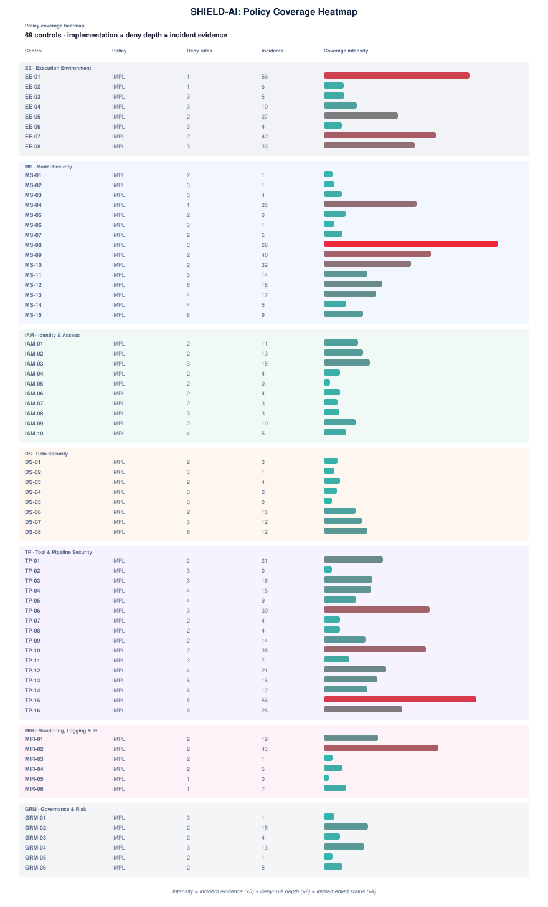

# 08 · Policy Coverage Heatmap

How deep is each control's executable verification? A glanceable grid of implementation status, deny-rule depth, and incident evidence per control, derived from the committed policies and incident catalogue so it stays current with the sources.

## Verification depth by pillar

| Pillar | Controls | Implemented | Deny rules | Incident refs |
|---|---|---|---|---|
| **EE** | 8 | 8 | 26 | 187 |
| **MS** | 15 | 15 | 77 | 257 |
| **IAM** | 10 | 10 | 37 | 68 |
| **DS** | 8 | 8 | 37 | 44 |
| **TP** | 16 | 16 | 88 | 301 |
| **MIR** | 6 | 6 | 16 | 75 |
| **GRM** | 6 | 6 | 21 | 39 |

## Reading the heat

- **Implementation status** - `IMPL` is an executable policy; `stub` is declared but not yet enforced.
- **Deny rules** - how many fail-closed conditions the policy enforces.
- **Incidents** - how many catalogue events evidence the control class; intensity shades cool (low) to hot (high).
