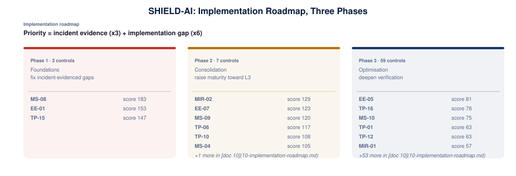

# 10 · Implementation Roadmap

Which controls to harden first. Ranking is evidence-weighted from the committed sources - incident evidence and implementation gap - so the sequence is transparent and reproducible.

## Method

Priority score = incident evidence (x3) + implementation gap (x6 when the executable policy is missing). Controls are bucketed into three phases.

## Phase 1 · Foundations (fix incident-evidenced gaps first)

| Priority | Control | Title | Score | Focus (fail-closed condition to address) |
|---|---|---|---|---|
| 1 | **MS-08** | MCP | 183 | MCP tool definitions from '...' are not cryptographically signed; MCP server '...' is not from a trusted registry |
| 2 | **EE-01** | Execution environment boundary enforcement | 153 | tool '...' is high-risk and agent '...' is not sandboxed (fail closed) |
| 3 | **TP-15** | In-process code-execution sandbox sufficiency | 147 | code execution by agent '...' runs LLM-generated/untrusted code outside an OS/VM-isolated boundary; code execution by agent '...' relies on an in-process denylist/blocklist gate as the sole containment; structurally bypassable |

## Phase 2 · Consolidation (raise maturity to L3)

| Priority | Control | Title | Score | Focus (fail-closed condition to address) |
|---|---|---|---|---|
| 1 | **MIR-02** | Behavioural anomaly detection baseline per-agent behaviour established over training period; alerts on deviation  --  unusual tool, unusual data access pattern, unusual frequency; | 129 | action by agent '...' deviates from its behaviour baseline; sensitive tool '...' from ephemeral sandbox agent '...' without campaign correlation (swarm class) |
| 2 | **EE-07** | Agent control-plane configuration integrity | 123 | agent configuration loaded from a world-writable location (config-trust class); agent control-plane path '...' is writable by the agent |
| 3 | **MS-09** | Perception-fidelity enforcement for human-in-the-loop approvals | 120 | approval evidence comes from an agent-generated attestation (sockpuppet class); out-of-band verification required; approval binds to content containing imperceptible marker '...' without a verified rendering-fidelity snapshot |
| 4 | **TP-06** | Dependency scanning | 117 | deployment with unscanned dependencies; critical-severity dependency finding not blocked |
| 5 | **TP-10** | Agent platform inbound control-plane protection | 108 | listener binding '...' is not on the approved binding list (default deny); web-origin binding '...' without origin validation (CSWSH class) |
| 6 | **MS-04** | Adversarial robustness | 105 | prompt-injection or imperceptible-content marker '...' found in agent-visible content |
| 7 | **EE-08** | Evaluation-harness isolation and integrity | 87 | evaluation run without a verified egress block (isolation asserted, not enforced); evaluation run without target collision-checking against real domains and assets |

## Phase 3 · Optimisation (deepen verification)

| Priority | Control | Title | Score | Focus (fail-closed condition to address) |
|---|---|---|---|---|
| 1 | **EE-05** | Host-trusted configuration file injection prevention | 81 | agent can write host-trusted path '...' (indirect escape class); agent '...' file write with no reported write-path allowlist (fail closed) |
| 2 | **TP-16** | Tool-connection and launch-path integrity | 78 | agent '...' connection hands server-supplied protocol metadata to a process-launch/shell primitive (code-execution boundary); agent '...' authorization endpoint is not origin-bound to the configured server |
| 3 | **MS-10** | Agent memory-store integrity | 75 | memory-store write by agent '...' is unauthenticated; memory-store write by agent '...' carries tamper evidence; store must be treated as compromised |
| 4 | **TP-01** | Tool inventory and registry | 63 | tool '...' is not in the approved tool registry |
| 5 | **TP-12** | Tool-call provenance and dispatch verification | 63 | dispatch without session provenance (fail closed); dispatch without turn provenance (fail closed) |
| 6 | **MIR-01** | Agent activity logging | 57 | audit record not written to append-only storage (integrity requirement); agent '...' action '...' has no structured audit record |
| 7 | **MS-12** | MCP discovery-metadata and shared-cache integrity | 51 | MCP discovery response for agent '...' carries unbounded server-supplied instructions; must be length-limited; MCP discovery response for agent '...' folds server-supplied instructions into the trusted system prompt; must be isolated as untrusted content |
| 8 | **TP-03** | API gateway security | 48 | tool '...' call not rate-limited by the gateway; tool '...' call payload not schema-validated by the gateway |
| 9 | **TP-13** | Agent dependency-install provenance verification | 48 | install by agent '...' references a package not confirmed to exist in the intended registry; install by agent '...' references a registry namespace not verified to belong to the documented vendor |
| 10 | **GRM-02** | AI risk register | 45 | kill-switch capability not exercised (AI-speed response requires one rehearsed red button); ... action not registered in the AI risk register |
| 11 | **IAM-03** | Human oversight controls | 45 | approval evidence from session history is not human approval (forged-approval class); financial action approved on the agent channel; human-console approval required |
| 12 | **TP-04** | Tool output validation | 45 | tool '...' output not validated against a known-good schema; tool '...' output not sanitised before entering agent context |
| 13 | **MS-11** | Operational data-stream integrity | 42 | agent action triggered by log/alert content from an unverified producer; instruction-bearing operational content acted on without independent non-log verification |
| 14 | **TP-09** | Explicit tool registration — no implicit tool exposure | 42 | tool '...' was not explicitly registered (implicit exposure class); tool '...' auto-registered by framework mechanism; explicit registration required |
| 15 | **GRM-04** | Third-party AI risk management | 39 | action using third-party vendor '...' without security assessment; vendor '...' without contractual security control obligations |
| 16 | **IAM-02** | Scope-bound delegation | 39 | agent '...' has no scope-bound delegation claim (fail closed); agent '...' has wildcard permissions |
| 17 | **MS-13** | Transcript and conversation authenticity | 36 | agent '...' reads a transcript whose model outputs are not signed at the model boundary; stored response cannot be verified as genuine; agent '...' proceeds from an unverified transcript; every stored response must be verified on read before reasoning |
| 18 | **TP-14** | Skill/plugin payload integrity and instruction-channel isolation | 36 | execute skill '...' for agent '...' with an unsigned payload; never execute unsigned; execute skill '...' for agent '...' whose payload is not immutable at install time |
| 19 | **IAM-01** | Agent identity management | 33 | agent '...' has no unique identity (sharing human credentials); agent '...' identity is not auditable |
| 20 | **DS-06** | Output validation | 30 | output not verified clean by the leakage scanner (fail closed); output flagged for data leakage (PII, training data, system prompt, or credential) |
| 21 | **EE-04** | Evaluation sandbox integrity | 30 | evaluation run with unverified evaluation-to-production isolation (fail closed); evaluation run has a network path to production |
| 22 | **IAM-09** | Multi-tenant agent platform isolation | 30 | request not scoped to tenant ID at the data layer (presentation-layer checks only); user-controlled object ID bypasses tenant scoping (CWE-639 IDOR class) |
| 23 | **MS-15** | Cross-tenant agent memory and state isolation | 27 | pooled memory_read by agent '...' returned a cross-tenant hit (owner != querying principal); hard ownership gate must drop it; pooled memory_read by agent '...' could not verify ownership of a hit; fail closed per default-deny (semantic similarity is not an admissibility proxy) |
| 24 | **TP-05** | Pipeline integrity | 27 | deployment from an unsigned CI/CD run; deployment without pipeline attestation |
| 25 | **DS-07** | Agent-originated artifact publication control | 24 | execution-bearing configuration write requires human-console approval (Kiro class); agent publication to '...' lacks the required out-of-band approval |
| 26 | **MIR-06** | Forensic readiness | 21 | high-impact action '...' by agent '...' is not reconstructible from immutable logs |
| 27 | **TP-11** | Agent browser and content-rendering isolation | 21 | document upload rendered without sanitisation before assistant processing; token access from rendered content without approval (credential-layer isolation) |
| 28 | **EE-02** | Infrastructure API access control | 18 | agent call to infrastructure API '...' without explicit tool registration |
| 29 | **MS-05** | Model behaviour validation | 18 | output by agent '...' not evaluated by proxy-layer guardrails (fail closed); output by agent '...' outside its configured behaviour scope |
| 30 | **EE-03** | Resource usage limiting | 15 | agent '...' CPU usage ...% exceeds limit ...%; agent '...' network usage ... Mbps exceeds limit ... Mbps |
| 31 | **GRM-06** | Board and executive reporting | 15 | no executive dashboard for AI security posture (maturity, findings, compliance, risk acceptances); risk acceptance decision not logged in the executive reporting trail |
| 32 | **IAM-10** | Taint-tracked least-privilege subagent scoping | 15 | agent '...' processed an externally-submitted record that was not taint-marked at ingestion; agent '...' reads a tainted record without field-level least-privilege scoping (must be narrower than nominal grants) |
| 33 | **MIR-04** | Incident response playbooks AI-specific IR procedures distinct from general IR: prompt injection containment, model rollback, tool access revocation, session invalidation; | 15 | ... incident acknowledged without a named AI-specific IR playbook; ... incident without an automatic containment step (agent-speed response) |
| 34 | **MS-07** | Deployment context obfuscation | 15 | evaluation environment distinguishable from production (endpoints, data shapes, latency); evaluation behaviour diverges from production for the same inputs (subversion indicator) |
| 35 | **MS-14** | Self-replication barrier | 15 | outbound publish by agent '...' matches an instruction-bearing n-gram fingerprint (replication vector) and is not quarantined; outbound publish by agent '...' is a fingerprinted replication match that lacks human approval |
| 36 | **DS-03** | Memory sanitisation | 12 | agent '...' persists classified or sensitive data beyond session lifetime; agent '...' session ended without memory wipe (cross-session leakage risk) |
| 37 | **DS-08** | Destination and emergent-channel egress inventory | 12 | agent '...' egress to destination not on the payload-blind allow-list; agent '...' egress through an un-inventoried sink (channel not enumerated/mapped to a control) |
| 38 | **EE-06** | Fail-closed sandbox operation | 12 | interpreter isolation flags are a convenience feature, not a security boundary; no sandbox attestation before code execution by agent '...' (fail closed) |
| 39 | **GRM-03** | Ethical use policy | 12 | high-risk tier agent deployed without human-in-the-loop requirement per risk tier; action '...' outside the documented acceptable-use boundary for agent '...' |
| 40 | **IAM-04** | Credential isolation | 12 | agent '...' credentials not isolated from human credentials; agent '...' compromise signal without credential rotation |
| 41 | **IAM-06** | Cross-session boundary enforcement | 12 | agent '...' session shares credentials across sessions; agent '...' session is not an independent security context |
| 42 | **MS-03** | Supply chain security | 12 | model '...' deployed without an ML component SBOM; model '...' provenance signature not verified |
| 43 | **TP-07** | Cross-tool dependency analysis | 12 | deployment without cross-tool dependency (transitive risk) analysis; tool combination enables an escape-class chain without explicit risk acceptance (GRM-02) |
| 44 | **TP-08** | API gateway infrastructure-isolation mode | 12 | tool '...' call without an active gateway API allow-list; infrastructure control-plane API '...' not blocked by the gateway (infra-isolation mode off) |
| 45 | **DS-01** | Data classification and labelling | 9 | data ingestion without automated classification (fail closed); data ingestion with no classification label |
| 46 | **IAM-07** | Transitive delegation chain enforcement | 9 | delegation chain for agent '...' is ... hops, exceeding the bound of ...; delegation chain for agent '...' is not reconstructable from audit logs |
| 47 | **IAM-08** | Credential scope narrowing | 9 | agent '...' holds a broad service role instead of per-tool scoped credentials; agent '...' credentials are not scoped per registered tool |
| 48 | **DS-04** | Data minimisation | 6 | bulk data access by agent (field-level filtering required); retrieval without field-level filtering (document-level only) |
| 49 | **DS-02** | Inference data protection | 3 | inference data not encrypted end-to-end; inference transport below TLS 1.3 minimum |
| 50 | **GRM-01** | AI governance body | 3 | deployment without a chartered AI governance body; AI governance body lacks cross-functional membership (CISO, CRO, GC, data owner, AI lead) |
| 51 | **GRM-05** | Regulatory mapping and compliance reporting | 3 | deployment without an automated regulatory mapping (ISM, E8, SOCI, CPS 234, PSPF, Privacy Act); compliance posture not reported on the quarterly cadence |
| 52 | **MIR-03** | Prompt audit log | 3 | sensitive prompt/response pair not captured for the audit log; captured prompt/response pair not redacted before SIEM ingestion |
| 53 | **MS-01** | Model weight protection | 3 | model '...' weights not encrypted at rest and in transit; model '...' weights lack key management (HSM or cloud KMS required) |
| 54 | **MS-02** | Training data integrity | 3 | training run with untracked dataset provenance; training run with unsanitised dataset (PII or sensitive content) |
| 55 | **MS-06** | Model inventory and lineage tracking | 3 | model '...' not registered in the model inventory; model '...' has no traceable lineage |
| 56 | **DS-05** | Training data governance | 0 | training run without dataset lineage tracking; training run on personal data without verified consent |
| 57 | **IAM-05** | Just-in-time access | 0 | agent '...' has standing (non-ephemeral) credentials; agent '...' session expired without credential revocation |
| 58 | **MIR-05** | Mandatory reporting integration | 0 | incident reported by agent '...' has no regulatory reporting trigger (SOCI 12h / APRA 72h windows) |
| 59 | **TP-02** | Tool access control | 0 | tool '...' call not authenticated to the agent identity; tool '...' authenticated against the human session, not the agent identity |

## Ten highest-priority controls

1. **MS-08** (183) - MCP tool definitions from '...' are not cryptographically signed
2. **EE-01** (153) - tool '...' is high-risk and agent '...' is not sandboxed (fail closed)
3. **TP-15** (147) - code execution by agent '...' runs LLM-generated/untrusted code outside an OS/VM-isolated boundary
4. **MIR-02** (129) - action by agent '...' deviates from its behaviour baseline
5. **EE-07** (123) - agent configuration loaded from a world-writable location (config-trust class)
6. **MS-09** (120) - approval evidence comes from an agent-generated attestation (sockpuppet class); out-of-band verification required
7. **TP-06** (117) - deployment with unscanned dependencies
8. **TP-10** (108) - listener binding '...' is not on the approved binding list (default deny)
9. **MS-04** (105) - prompt-injection or imperceptible-content marker '...' found in agent-visible content
10. **EE-08** (87) - evaluation run without a verified egress block (isolation asserted, not enforced)

See [06 · Technical Verification](06-controls-technical.md) for full per-control checklists.
