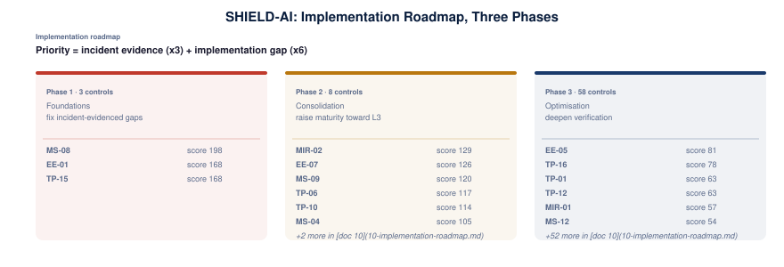

# 10 · Implementation Roadmap

Which controls to harden first. Ranking is evidence-weighted from the committed sources - incident evidence and implementation gap - so the sequence is transparent and reproducible.

## Method

Priority score = incident evidence (x3) + implementation gap (x6 when the executable policy is missing). Controls are bucketed into three phases.

## Phase 1 · Foundations (fix incident-evidenced gaps first)

| Priority | Control | Title | Score | Focus (fail-closed condition to address) |
|---|---|---|---|---|
| 1 | **MS-08** | MCP | 204 | ... deny: input carries a schema_version not supported by this policy; MCP tool definitions from '...' are not cryptographically signed |
| 2 | **EE-01** | Execution environment boundary enforcement | 174 | ... deny: input carries a schema_version not supported by this policy; tool '...' is high-risk and agent '...' is not sandboxed (fail closed) |
| 3 | **TP-15** | In-process code-execution sandbox sufficiency | 171 | missing attestation for input.action.code.sandboxed_os_vm (unobserved -> fail closed); missing attestation for input.action.code.template_render_isolated (unobserved -> fail closed) |

## Phase 2 · Consolidation (raise maturity to L3)

| Priority | Control | Title | Score | Focus (fail-closed condition to address) |
|---|---|---|---|---|
| 1 | **MIR-02** | Behavioural anomaly detection baseline per-agent behaviour established over training period; alerts on deviation  --  unusual tool, unusual data access pattern, unusual frequency; | 129 | ... deny: input carries a schema_version not supported by this policy; action by agent '...' deviates from its behaviour baseline |
| 2 | **EE-07** | Agent control-plane configuration integrity | 126 | agent configuration loaded from a world-writable location (config-trust class); ... deny: input carries a schema_version not supported by this policy |
| 3 | **MS-09** | Perception-fidelity enforcement for human-in-the-loop approvals | 120 | approval evidence comes from an agent-generated attestation (sockpuppet class); out-of-band verification required; ... deny: input carries a schema_version not supported by this policy |
| 4 | **TP-06** | Dependency scanning | 117 | deployment with unscanned dependencies; critical-severity dependency finding not blocked |
| 5 | **TP-10** | Agent platform inbound control-plane protection | 114 | ... deny: input carries a schema_version not supported by this policy; listener binding '...' is not on the approved binding list (default deny) |
| 6 | **MS-04** | Adversarial robustness | 105 | ... deny: input carries a schema_version not supported by this policy; prompt-injection or imperceptible-content marker '...' found in agent-visible content |
| 7 | **EE-08** | Evaluation-harness isolation and integrity | 99 | evaluation run without a verified egress block (isolation asserted, not enforced); evaluation run without target collision-checking against real domains and assets |
| 8 | **MS-10** | Agent memory-store integrity | 96 | ... deny: input carries a schema_version not supported by this policy; memory-store write by agent '...' is unauthenticated |

## Phase 3 · Optimisation (deepen verification)

| Priority | Control | Title | Score | Focus (fail-closed condition to address) |
|---|---|---|---|---|
| 1 | **EE-05** | Host-trusted configuration file injection prevention | 87 | ... deny: input carries a schema_version not supported by this policy; agent can write host-trusted path '...' (indirect escape class) |
| 2 | **TP-16** | Tool-connection and launch-path integrity | 84 | missing attestation for input.action.connection.auth_endpoint_origin_bound (unobserved -> fail closed); missing attestation for input.action.connection.auth_endpoint_validated_canonical (unobserved -> fail closed) |
| 3 | **TP-01** | Tool inventory and registry | 63 | ... deny: input carries a schema_version not supported by this policy; tool '...' is not in the approved tool registry |
| 4 | **TP-12** | Tool-call provenance and dispatch verification | 63 | dispatch without session provenance (fail closed); dispatch without turn provenance (fail closed) |
| 5 | **MIR-01** | Agent activity logging | 57 | audit record not written to append-only storage (integrity requirement); ... deny: input carries a schema_version not supported by this policy |
| 6 | **MS-12** | MCP discovery-metadata and shared-cache integrity | 54 | missing attestation for input.action.discovery.instructions_length_limited (unobserved -> fail closed); missing attestation for input.action.discovery.instructions_isolated (unobserved -> fail closed) |
| 7 | **MS-13** | Transcript and conversation authenticity | 51 | missing attestation for input.action.transcript.model_output_signed (unobserved -> fail closed); missing attestation for input.action.transcript.verified_on_read (unobserved -> fail closed) |
| 8 | **TP-03** | API gateway security | 48 | ... deny: input carries a schema_version not supported by this policy; tool '...' call not rate-limited by the gateway |
| 9 | **TP-13** | Agent dependency-install provenance verification | 48 | missing attestation for input.action.dependency.registry_exists (unobserved -> fail closed); missing attestation for input.action.dependency.namespace_owned (unobserved -> fail closed) |
| 10 | **GRM-02** | AI risk register | 45 | kill-switch capability not exercised (AI-speed response requires one rehearsed red button); ... deny: input carries a schema_version not supported by this policy |
| 11 | **IAM-03** | Human oversight controls | 45 | approval evidence from session history is not human approval (forged-approval class); financial action approved on the agent channel; human-console approval required |
| 12 | **TP-04** | Tool output validation | 45 | ... deny: input carries a schema_version not supported by this policy; tool '...' output not validated against a known-good schema |
| 13 | **MS-11** | Operational data-stream integrity | 42 | agent action triggered by log/alert content from an unverified producer; instruction-bearing operational content acted on without independent non-log verification |
| 14 | **TP-09** | Explicit tool registration — no implicit tool exposure | 42 | ... deny: input carries a schema_version not supported by this policy; tool '...' was not explicitly registered (implicit exposure class) |
| 15 | **GRM-04** | Third-party AI risk management | 39 | ... deny: input carries a schema_version not supported by this policy; action using third-party vendor '...' without security assessment |
| 16 | **IAM-02** | Scope-bound delegation | 39 | ... deny: input carries a schema_version not supported by this policy; agent '...' has no scope-bound delegation claim (fail closed) |
| 17 | **DS-07** | Agent-originated artifact publication control | 36 | execution-bearing configuration write requires human-console approval (Kiro class); ... deny: input carries a schema_version not supported by this policy |
| 18 | **DS-08** | Destination and emergent-channel egress inventory | 36 | missing attestation for input.action.egress.destination_allowlisted (unobserved -> fail closed); missing attestation for input.action.egress.channel_inventoried (unobserved -> fail closed) |
| 19 | **TP-14** | Skill/plugin payload integrity and instruction-channel isolation | 36 | missing attestation for input.action.skill.payload_signed (unobserved -> fail closed); missing attestation for input.action.skill.payload_immutable (unobserved -> fail closed) |
| 20 | **IAM-01** | Agent identity management | 33 | ... deny: input carries a schema_version not supported by this policy; agent '...' has no unique identity (sharing human credentials) |
| 21 | **DS-06** | Output validation | 30 | output not verified clean by the leakage scanner (fail closed); output flagged for data leakage (PII, training data, system prompt, or credential) |
| 22 | **EE-04** | Evaluation sandbox integrity | 30 | evaluation run with unverified evaluation-to-production isolation (fail closed); evaluation run has a network path to production |
| 23 | **IAM-09** | Multi-tenant agent platform isolation | 30 | request not scoped to tenant ID at the data layer (presentation-layer checks only); user-controlled object ID bypasses tenant scoping (CWE-639 IDOR class) |
| 24 | **MS-15** | Cross-tenant agent memory and state isolation | 30 | missing attestation for input.action.connection_params_bound (unobserved -> fail closed); ... deny: input carries a schema_version not supported by this policy |
| 25 | **TP-05** | Pipeline integrity | 27 | deployment from an unsigned CI/CD run; deployment without pipeline attestation |
| 26 | **MIR-06** | Forensic readiness | 21 | ... deny: input carries a schema_version not supported by this policy; high-impact action '...' by agent '...' is not reconstructible from immutable logs |
| 27 | **TP-11** | Agent browser and content-rendering isolation | 21 | document upload rendered without sanitisation before assistant processing; token access from rendered content without approval (credential-layer isolation) |
| 28 | **EE-02** | Infrastructure API access control | 18 | ... deny: input carries a schema_version not supported by this policy; agent call to infrastructure API '...' without explicit tool registration |
| 29 | **MS-05** | Model behaviour validation | 18 | ... deny: input carries a schema_version not supported by this policy; output by agent '...' not evaluated by proxy-layer guardrails (fail closed) |
| 30 | **EE-03** | Resource usage limiting | 15 | ... deny: input carries a schema_version not supported by this policy; agent '...' CPU usage ...% exceeds limit ...% |
| 31 | **GRM-06** | Board and executive reporting | 15 | no executive dashboard for AI security posture (maturity, findings, compliance, risk acceptances); risk acceptance decision not logged in the executive reporting trail |
| 32 | **IAM-10** | Taint-tracked least-privilege subagent scoping | 15 | missing attestation for input.action.record.taint_marked (unobserved -> fail closed); missing attestation for input.action.record.field_level_scoped (unobserved -> fail closed) |
| 33 | **MIR-04** | Incident response playbooks AI-specific IR procedures distinct from general IR: prompt injection containment, model rollback, tool access revocation, session invalidation; | 15 | ... deny: input carries a schema_version not supported by this policy; ... incident acknowledged without a named AI-specific IR playbook |
| 34 | **MS-07** | Deployment context obfuscation | 15 | evaluation environment distinguishable from production (endpoints, data shapes, latency); evaluation behaviour diverges from production for the same inputs (subversion indicator) |
| 35 | **MS-14** | Self-replication barrier | 15 | missing attestation for input.action.outbound.quarantined (unobserved -> fail closed); missing attestation for input.action.outbound.human_approved (unobserved -> fail closed) |
| 36 | **DS-03** | Memory sanitisation | 12 | ... deny: input carries a schema_version not supported by this policy; agent '...' persists classified or sensitive data beyond session lifetime |
| 37 | **EE-06** | Fail-closed sandbox operation | 12 | interpreter isolation flags are a convenience feature, not a security boundary; ... deny: input carries a schema_version not supported by this policy |
| 38 | **GRM-03** | Ethical use policy | 12 | missing attestation for input.action.acceptable (unobserved -> fail closed); high-risk tier agent deployed without human-in-the-loop requirement per risk tier |
| 39 | **IAM-04** | Credential isolation | 12 | ... deny: input carries a schema_version not supported by this policy; agent '...' credentials not isolated from human credentials |
| 40 | **IAM-06** | Cross-session boundary enforcement | 12 | ... deny: input carries a schema_version not supported by this policy; agent '...' session shares credentials across sessions |
| 41 | **MS-03** | Supply chain security | 12 | ... deny: input carries a schema_version not supported by this policy; model '...' deployed without an ML component SBOM |
| 42 | **TP-07** | Cross-tool dependency analysis | 12 | deployment without cross-tool dependency (transitive risk) analysis; tool combination enables an escape-class chain without explicit risk acceptance (GRM-02) |
| 43 | **TP-08** | API gateway infrastructure-isolation mode | 12 | ... deny: input carries a schema_version not supported by this policy; tool '...' call without an active gateway API allow-list |
| 44 | **DS-01** | Data classification and labelling | 9 | data ingestion without automated classification (fail closed); data ingestion with no classification label |
| 45 | **IAM-07** | Transitive delegation chain enforcement | 9 | ... deny: input carries a schema_version not supported by this policy; delegation chain for agent '...' is ... hops, exceeding the bound of ... |
| 46 | **IAM-08** | Credential scope narrowing | 9 | ... deny: input carries a schema_version not supported by this policy; agent '...' holds a broad service role instead of per-tool scoped credentials |
| 47 | **DS-04** | Data minimisation | 6 | bulk data access by agent (field-level filtering required); retrieval without field-level filtering (document-level only) |
| 48 | **DS-02** | Inference data protection | 3 | inference data not encrypted end-to-end; inference transport below TLS 1.3 minimum |
| 49 | **GRM-01** | AI governance body | 3 | input carries a schema_version not supported by this policy; deployment without a chartered AI governance body |
| 50 | **GRM-05** | Regulatory mapping and compliance reporting | 3 | deployment without an automated regulatory mapping (ISM, E8, SOCI, CPS 234, PSPF, Privacy Act); compliance posture not reported on the quarterly cadence |
| 51 | **MIR-03** | Prompt audit log | 3 | sensitive prompt/response pair not captured for the audit log; captured prompt/response pair not redacted before SIEM ingestion |
| 52 | **MS-01** | Model weight protection | 3 | ... deny: input carries a schema_version not supported by this policy; model '...' weights not encrypted at rest and in transit |
| 53 | **MS-02** | Training data integrity | 3 | training run with untracked dataset provenance; training run with unsanitised dataset (PII or sensitive content) |
| 54 | **MS-06** | Model inventory and lineage tracking | 3 | ... deny: input carries a schema_version not supported by this policy; model '...' not registered in the model inventory |
| 55 | **DS-05** | Training data governance | 0 | training run without dataset lineage tracking; training run on personal data without verified consent |
| 56 | **IAM-05** | Just-in-time access | 0 | ... deny: input carries a schema_version not supported by this policy; agent '...' has standing (non-ephemeral) credentials |
| 57 | **MIR-05** | Mandatory reporting integration | 0 | ... deny: input carries a schema_version not supported by this policy; incident reported by agent '...' has no regulatory reporting trigger (SOCI 12h / APRA 72h windows) |
| 58 | **TP-02** | Tool access control | 0 | missing attestation for input.action.tool_allowed (unobserved -> fail closed); ... deny: input carries a schema_version not supported by this policy |

## Ten highest-priority controls

1. **MS-08** (204) - ... deny: input carries a schema_version not supported by this policy
2. **EE-01** (174) - ... deny: input carries a schema_version not supported by this policy
3. **TP-15** (171) - missing attestation for input.action.code.sandboxed_os_vm (unobserved -> fail closed)
4. **MIR-02** (129) - ... deny: input carries a schema_version not supported by this policy
5. **EE-07** (126) - agent configuration loaded from a world-writable location (config-trust class)
6. **MS-09** (120) - approval evidence comes from an agent-generated attestation (sockpuppet class); out-of-band verification required
7. **TP-06** (117) - deployment with unscanned dependencies
8. **TP-10** (114) - ... deny: input carries a schema_version not supported by this policy
9. **MS-04** (105) - ... deny: input carries a schema_version not supported by this policy
10. **EE-08** (99) - evaluation run without a verified egress block (isolation asserted, not enforced)

See [06 · Technical Verification](06-controls-technical.md) for full per-control checklists.
