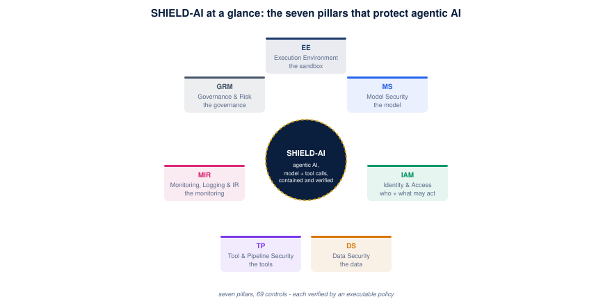
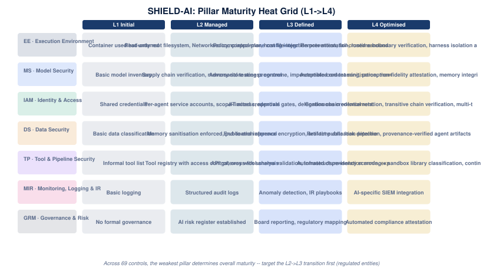

# 11 · Executive One-Pager

A one-page view for a board member or senior executive, derived from the committed framework and incident evidence.

## The picture in numbers

- **69 controls** across the seven pillars that protect the model, identity, data, tools, monitoring, and governance of agentic AI.
- **69 controls (100%)** already have an executable verification policy enforcing **195** fail-closed conditions.
- **912 control-incident references** in the catalogue (92 events) show where real-world risk actually surfaces.

## Top controls to harden

- **MS-08: MCP** - limits what tools an AI agent may call (Model Context Protocol servers). Shown up by 61 of the catalogue incidents. Evidence: [incident summary](07-incident-summaries.md#inc-12-mcp-protocol-layer-vulnerabilities).
- **EE-01: Execution environment boundary enforcement** - keeps every AI agent execution inside a defended sandbox. Shown up by 51 of the catalogue incidents. Evidence: [incident summary](07-incident-summaries.md#inc-11-pillar-security-week-of-sandbox-escapes).
- **TP-15: In-process code-execution sandbox sufficiency** - forces untrusted code the agent runs into an OS- or VM-isolated sandbox. Shown up by 49 of the catalogue incidents. Evidence: [incident summary](07-incident-summaries.md#inc-58-in-process-denylistblocklist-code-execution-sandbox-bypass).

## Recommended next steps

- Close the highest-evidenced gaps first - the controls most often shown up by real incidents are where hardening pays fastest.
- Raise each pillar toward **L3** (automated, board-reported security), the level regulated Australian entities target.
- Keep every control verified by an executable policy so posture is measured, not asserted.

## What SHIELD-AI protects

The seven pillars wrap the agent and the model. Each pillar is a set of controls -
about the model, who and what it may touch, the data it handles, the tools it
invokes, the monitoring around it, the governance over it, and the sandbox that
contains it. Every control is verified by an executable policy you can run.

## Where we stand

The heat grid shows each pillar's position on the L1 (initial) to L4 (optimised)
maturity curve - the target for Australian regulated entities is **L3**, the level
at which security becomes automated and board-reported. The weakest pillar sets
the organisation's overall maturity.

- **EE (Execution Environment):** L3 target - seccomp/apparmor, host file-injection prevention, fail-closed sandbox operation, eval-harness verification.
- **MS (Model Security):** L3 target - Adversarial testing programme, imperceptible-content sanitisation, memory tamper detection.
- **IAM (Identity & Access):** L3 target - JIT access, approval gates, delegation chain enforcement.
- **DS (Data Security):** L3 target - End-to-end inference encryption, artifact publication pipeline.
- **TP (Tool & Pipeline Security):** L3 target - API gateway with schema validation, infrastructure-isolation mode, explicit tool registration, inbound binding policy, browser/content-rendering isolation.
- **MIR (Monitoring, Logging & IR):** L3 target - Anomaly detection, IR playbooks.
- **GRM (Governance & Risk):** L3 target - Board reporting, regulatory mapping.

Every control in every pillar is verified by an executable policy, so posture is
measured, not asserted. The field guide shows the exact checks: [06 · Technical
Verification](06-controls-technical.md).
